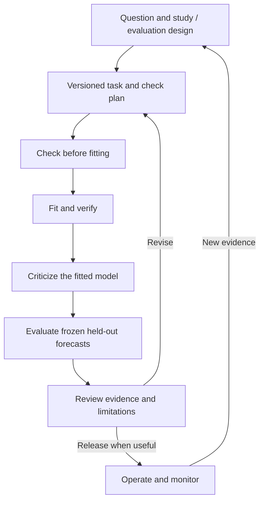

# Model Pipelining

A small framework for reproducible forecasting experiments: change the model while keeping data handling, backtesting, evaluation, and saved results consistent.

The project starts with time-indexed numerical targets. It should support Bayesian models, classical models, and machine-learning models through a shared execution boundary, with checks appropriate to each model.

**Status: design and repository scaffold.** There is no runnable pipeline, fitted model, dataset, or completed experiment yet. We will make implementation decisions in small, reviewable steps.

## Why build this?

The goal is to learn model development while building infrastructure that can be reused across applications. A baseline, a Bayesian dynamic linear model (BDLM), and a gradient-boosting model should be comparable without rewriting the runner or result storage.

The framework should preserve more than a winning score. It should make it possible to inspect the question, assumptions, checks, forecasts, failures, and revisions that produced a result.

The first end-to-end exercise will use synthetic data and a simple baseline. A later personal application may use one market series. A separate operational application can follow once the core responsibilities are clear.

## Design starts with the question

Before selecting a model, define the target, intended use, information available at prediction time, benchmark, and evaluation protocol. Distinguish forecasting, monitoring, and causal effect estimation: each needs a design that supports its intended claim.

The initial implementation focuses on forecasting. A backtest evaluates predictive performance; estimating the effect of an intervention requires a separate causal design and assumptions.

## Shared workflow



This is a map of responsibilities. The runner's exact stages and interfaces will be settled during implementation. Simulation studies can support several stages, and backtests repeat fitting and forecasting across historical origins.

**Shared structure, model-specific evidence:**

| Responsibility | Shared framework | Model contribution |
|---|---|---|
| Define the experiment | Task, calendar, availability, benchmark, and comparison cases | Declared capabilities and configuration |
| Check before fitting | Validate inputs and the required check plan | Prior predictive simulation for a Bayesian model; feature/schema checks for a boosting adapter |
| Fit and verify | Schedule eligible training data and record failures | Analytic-update checks, applicable sampler diagnostics, or fitting diagnostics |
| Criticize the fitted model | Preserve and display development evidence | Predictive replications, sensitivity, residual patterns, or other relevant checks |
| Evaluate | Compare common forecast cases and compatible outputs | Point forecasts and any explicitly supported uncertainty |
| Review and revise | Preserve lineage, limitations, and decisions | Explain model-specific evidence and proposed changes |

The experiment owns check requirements and failure policy. Adapters supply specialized checks. A point-only model does not need invented uncertainty, and an analytic Bayesian filter does not need MCMC diagnostics.

## Architecture at a glance

Three responsibilities stay separate:

- **Application:** what to predict, when to issue it, which data are eligible, and what a useful result means.
- **Model adapter:** how the model fits, predicts, declares capabilities, and supplies its checks.
- **Shared pipeline:** how experiments execute, outputs are validated, results are evaluated and stored, and evidence is reviewed.

Reports read saved artifacts. Predictions are frozen before actuals are used for scoring. Model-specific diagnostics keep their meaning while sharing a result format.

Read [the architecture](docs/architecture.md) for boundaries and [the decision log](docs/decisions.md) for what is settled versus open.

## Repository layout

```text
model-pipelining/
  README.md                  project entry point
  docs/
    architecture.md          responsibilities and information boundaries
    roadmap.md               small milestones and the next design slice
    decisions.md             decisions, proposals, and open questions
    references.md            public background reading
  src/model_pipelining/      reserved for the future Python implementation
  configs/                   reserved for task/model/check-plan examples
  tests/                     reserved for behavioral verification
  data/                      local input snapshots; contents ignored by Git
  runs/                      local run artifacts; contents ignored by Git
  .github/
    ISSUE_TEMPLATE/          a template for small design/build tasks
    pull_request_template.md review context for each change
```

The code, config, and test directories currently contain orientation notes. We will add modules and packaging when the first slice needs them. Exact dependencies, Python version, configuration format, and storage schemas remain open.

## First useful milestone

Produce one reproducible synthetic baseline experiment:

1. Preserve a small synthetic time series and a task specification.
2. Run a training-mean baseline through rolling-origin evaluation.
3. Validate forecast alignment and information availability.
4. Save configuration, predictions, scores, check outcomes, and a review record.
5. Produce one chart from saved results, with no fitting in the report.

Success means the experiment is understandable and repeatable, including visible failures. It does not depend on beating a complex model or demonstrating market forecasting skill.

After a review, add one real-data application and a local-level BDLM through the same infrastructure. A contrasting point-only adapter later tests whether the design generalizes.

See [the roadmap](docs/roadmap.md) for proposed milestones. The next step is to agree on the smallest synthetic experiment, not to build every component above at once.

## Working on the project

Use one issue or small pull request per question or deliverable. Describe the problem, intended behavior, and evidence needed before adding abstractions. Record consequential decisions in `docs/decisions.md`; keep unresolved choices explicitly provisional.

Verification should target behavior: no future information, correct target alignment, reproducible artifacts, visible failed folds, and honest capability handling. Code checks and CI will be added with executable code.

## GitHub setup

This repository can be tracked on GitHub as a documentation-first project. After creating an empty GitHub repository, connect and push from the project directory:

```bash
git remote add origin <repository-url>
git push -u origin main
```

Choose visibility and licensing when publishing. The scaffold has no selected open-source license or configured GitHub remote.

## Background

The workflow is informed by Gelman et al.'s *Bayesian workflow*, especially iterative model building, simulation, predictive checks, and comparison. The shared adapter/check architecture is a project design choice. See [references](docs/references.md).
