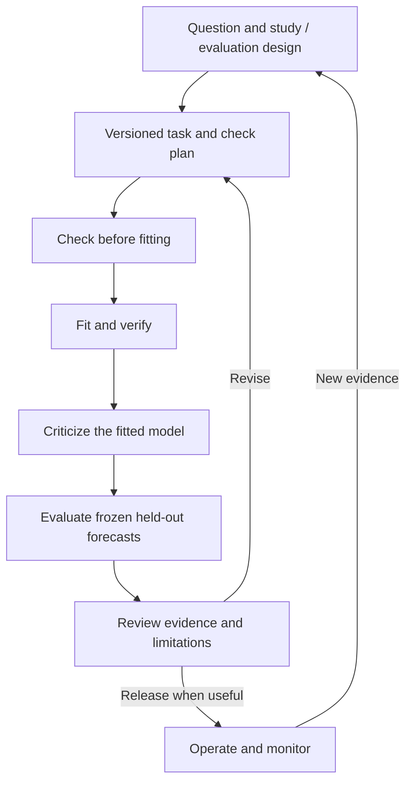

# Model Pipelining

A small framework for reproducible forecasting experiments: change the model while keeping data handling, backtesting, evaluation, and saved results consistent.

The project starts with time-indexed numerical targets. It should support Bayesian models, classical models, and machine-learning models through a shared execution boundary, with checks appropriate to each model.

**Status: project design, Python environment configuration, and synthetic data generation.** A reproducible generator creates two local synthetic datasets; see [the data notes](data/README.md). There is no runnable pipeline, fitted model, or completed experiment yet. We will make implementation decisions in small, reviewable steps.

## Why build this?

The goal is to learn model development while building infrastructure that can be reused across applications. A baseline, a Bayesian dynamic linear model (BDLM), and a gradient-boosting model should be comparable without rewriting the runner or result storage.

The framework should preserve more than a winning score. It should make it possible to inspect the question, assumptions, checks, forecasts, failures, and revisions that produced a result.

The first end-to-end exercise will use synthetic data and a simple baseline. A later personal application may use one market series. A separate operational application can follow once the core responsibilities are clear.

## Design starts with the question

Before selecting a model, define the target, intended use, information available at prediction time, benchmark, and evaluation protocol. Distinguish forecasting, monitoring, and causal effect estimation: each needs a design that supports its intended claim.

The initial implementation focuses on forecasting. A backtest evaluates predictive performance; estimating the effect of an intervention requires a separate causal design and assumptions.

## Shared workflow



This is a map of responsibilities. The runner's exact stages and interfaces will be settled during implementation. Simulation studies can support several stages, and backtests repeat fitting and forecasting across historical origins.

**Shared structure, model-specific evidence:**

| Responsibility | Shared framework | Model contribution |
|---|---|---|
| Define the experiment | Task, calendar, availability, benchmark, and comparison cases | Declared capabilities and configuration |
| Check before fitting | Validate inputs and the required check plan | Prior predictive simulation for a Bayesian model; feature/schema checks for a boosting adapter |
| Fit and verify | Schedule eligible training data and record failures | Analytic-update checks, applicable sampler diagnostics, or fitting diagnostics |
| Criticize the fitted model | Preserve and display development evidence | Predictive replications, sensitivity, residual patterns, or other relevant checks |
| Evaluate | Compare common forecast cases and compatible outputs | Point forecasts and any explicitly supported uncertainty |
| Review and revise | Preserve lineage, limitations, and decisions | Explain model-specific evidence and proposed changes |

The experiment owns check requirements and failure policy. Adapters supply specialized checks. A point-only model does not need invented uncertainty, and an analytic Bayesian filter does not need MCMC diagnostics.

## Architecture at a glance

Three responsibilities stay separate:

- **Application:** what to predict, when to issue it, which data are eligible, and what a useful result means.
- **Model adapter:** how the model fits, predicts, declares capabilities, and supplies its checks.
- **Shared pipeline:** how experiments execute, outputs are validated, results are evaluated and stored, and evidence is reviewed.

Reports read saved artifacts. Predictions are frozen before actuals are used for scoring. Model-specific diagnostics keep their meaning while sharing a result format.

Read [the architecture](docs/architecture.md) for boundaries and [the decision log](docs/decisions.md) for what is settled versus open.

## Repository layout

```text
model-pipelining/
  README.md                  project entry point and setup instructions
  LICENSE                    Apache License 2.0
  pyproject.toml             project metadata and dependency declarations
  .python-version            recommended development interpreter
  uv.lock                    resolved dependency versions for uv
  requirements.txt           generated dependency export for pip
  docs/
    architecture.md          responsibilities and information boundaries
    roadmap.md               small milestones and the next design slice
    decisions.md             decisions, proposals, and open questions
    references.md            public background reading
  src/model_pipelining/      reserved for the future Python implementation
  configs/                   reserved for task/model/check-plan examples
  tests/                     reserved for behavioral verification
  scripts/                   reproducible synthetic data generator
  data/                      local input snapshots; contents ignored by Git
  runs/                      local run artifacts; contents ignored by Git
  .github/
    ISSUE_TEMPLATE/          a template for small design/build tasks
    pull_request_template.md review context for each change
```

The code, config, and test directories currently contain orientation notes. Python 3.14 is selected; modeling dependencies, configuration formats, and storage schemas remain open. Add package/build configuration when the first importable implementation is ready.

## Development environment

Use an isolated environment named `.venv`. The setup supports standard Python tooling and an optional uv workflow; the pipeline itself will not depend on uv.

| Setting | Starting choice |
|---|---|
| Supported interpreter | Standard CPython 3.14 (`>=3.14,<3.15`) |
| Recommended development patch | 3.14.10, recorded in `.python-version` |
| Project version | 0.1.0, recorded in `pyproject.toml`; the API is still being designed |
| Runtime and development dependencies | None selected yet |
| Local environment | `.venv/`, excluded from Git |

The local `.venv` was verified on 2026-11-03: it runs CPython 3.14.10 and is isolated from the base interpreter. Initial dependencies and development tools remain to be selected. On a new machine, create and verify an environment using one of the setup paths below.

`pyproject.toml` declares dependencies. `uv.lock` records the resolved versions. `requirements.txt` is a generated, pip-compatible export of that resolution, including development groups when present. Commit all three files and `.python-version`; keep the environment, caches, credentials, local data, and generated run outputs out of Git.

Python, project, and dependency versions are separate choices. Update the interpreter pin deliberately when adopting a newer patch. Adding a dependency requires updating the declaration, lockfile, and pip export together. No numerical, modeling, notebook, test, or formatting packages are installed by the initial configuration.

### Standard Python setup: venv and pip

Install an approved CPython 3.14 interpreter first; use 3.14.10 to match the development pin. The following commands assume a Linux/macOS shell and that `python3.14` is on your path. Unlike uv, `venv` and pip do not automatically select an interpreter from `.python-version` or enforce `requires-python` when installing a requirements file.

```bash
cd /path/to/model-pipelining
python3.14 --version
python3.14 -m venv .venv
source .venv/bin/activate
python -m pip install -r requirements.txt
python -m pip check
python -c "import sys; assert sys.version_info[:2] == (3, 14); assert sys.prefix != sys.base_prefix; print(sys.version); print(sys.executable)"
```

The version check enforces the supported minor version; compare the printed patch with `.python-version` for an exact match. If your Python installation lacks `venv` or pip, obtain those components through your environment's normal provisioning process.

On Windows PowerShell, replace environment creation and activation with:

```powershell
py -3.14 -m venv .venv
.\.venv\Scripts\Activate.ps1
```

Then use the same `python -m pip` and verification commands. Select `.venv` as your editor/notebook interpreter when those tools are introduced. Run `deactivate` to leave an activated environment.

At work, use the approved interpreter and package source with this pip route. A different Python minor version requires a separate compatibility decision and dependency resolution; a requirements export alone does not establish compatibility with that runtime.

### Optional setup with uv

If uv is installed, it can provision the pinned interpreter and create the environment from the lockfile:

```bash
cd /path/to/model-pipelining
uv python install 3.14.10
uv sync --locked
uv run --locked python -c "import sys; assert sys.version_info[:3] == (3, 14, 10); assert sys.prefix != sys.base_prefix; print(sys.version); print(sys.executable)"
```

`uv run` uses the project environment without requiring shell activation. Alternatively, activate `.venv` using the standard commands above. The first sync may need network access to provision the interpreter or dependencies.

### Maintaining dependency versions

Use `pyproject.toml` as the editable dependency declaration. With uv available, add an agreed runtime package with `uv add PACKAGE`, or a development tool with `uv add --dev PACKAGE`. Review the resulting changes and regenerate the pip export:

```bash
uv lock
uv export --locked --all-groups --no-emit-project --format requirements.txt --output-file requirements.txt
```

The export is tracked so a machine without uv can install the selected versions using pip. It currently contains comments only because no dependencies are selected. Do not hand-edit the generated export or use an unreviewed `pip freeze` of an unrelated environment as the project's dependency definition.

A pip-only work machine can consume the committed export without uv. If it needs a different dependency set or approved versions, make an explicit configuration change and regenerate the lock/export in an environment with the resolution tools available. pip installs from the export; it does not update `uv.lock`.

Use a fresh `.venv` when checking reproduction with pip: `pip install -r` does not remove unrelated packages already installed. uv's `sync --locked` reconciles the environment with the lockfile. Dependencies may also require platform support, so validate the selected stack on the actual work runtime when it becomes known.

Setup references: [Python's packaging guide](https://packaging.python.org/en/latest/guides/installing-using-pip-and-virtual-environments/), [uv project guide](https://docs.astral.sh/uv/guides/projects/), and [exporting a uv lockfile for pip](https://docs.astral.sh/uv/concepts/projects/export/).

## First useful milestone

Produce one reproducible synthetic baseline experiment:

1. Preserve a small synthetic time series and a task specification.
2. Run a training-mean baseline through rolling-origin evaluation.
3. Validate forecast alignment and information availability.
4. Save configuration, predictions, scores, check outcomes, and a review record.
5. Produce one chart from saved results, with no fitting in the report.

Success means the experiment is understandable and repeatable, including visible failures. It does not depend on beating a complex model or demonstrating market forecasting skill.

After a review, add one real-data application and a local-level BDLM through the same infrastructure. A contrasting point-only adapter later tests whether the design generalizes.

See [the roadmap](docs/roadmap.md) for proposed milestones. Before implementing the baseline, review [the saved data-versioning decisions and next steps](docs/data-versioning.md). They define how input snapshots, provenance, dataset-scoped tags, validation, and replaceable storage should work. The design is recorded; versioning code has not been implemented.

## Working on the project

Use one issue or small pull request per question or deliverable. Describe the problem, intended behavior, and evidence needed before adding abstractions. Record consequential decisions in `docs/decisions.md`; keep unresolved choices explicitly provisional.

Verification should target behavior: no future information, correct target alignment, reproducible artifacts, visible failed folds, and honest capability handling. Code checks and CI will be added with executable code.

## Repository and license

The GitHub repository is [aquinjay/model-pipelining](https://github.com/aquinjay/model-pipelining). The local `origin` remote is configured for fetch and push using `git@github.com:aquinjay/model-pipelining.git`.

The project is licensed under the [Apache License 2.0](LICENSE).

## Background

The workflow is informed by Gelman et al.'s *Bayesian workflow*, especially iterative model building, simulation, predictive checks, and comparison. The shared adapter/check architecture is a project design choice. See [references](docs/references.md).
