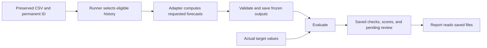
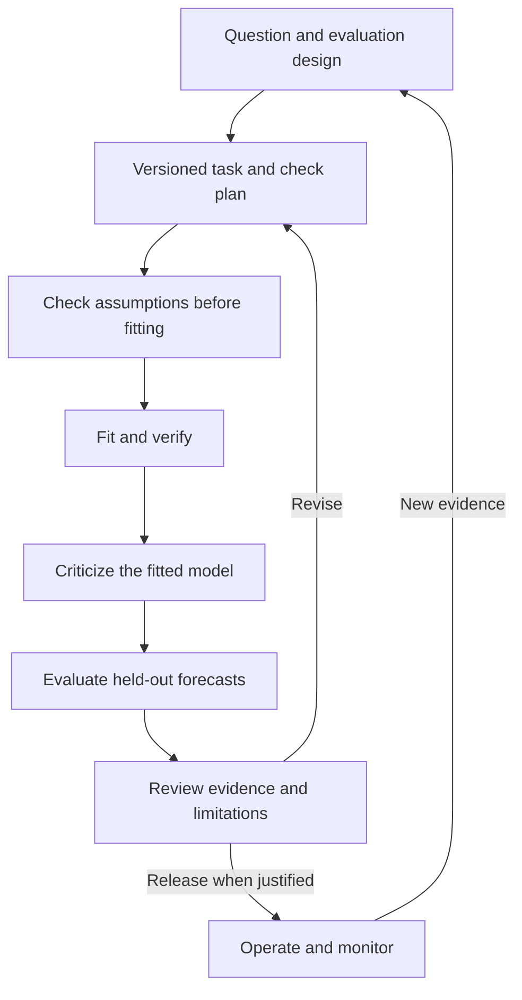

# Architecture: current behavior and future design

Read [the walkthrough](forecasting.md) for usage. This page explains responsibility
boundaries. Sections marked **implemented** describe code that exists; the later
workflow/checking sections are **design guidance**, not an implemented framework.

## Implemented execution path

The runner can parse/validate the complete input, but future actual values are
excluded from the request given to a model. Actuals are joined for scoring only
after forecast files are written and closed. This is a trusted Python boundary,
not a sandbox preventing an adapter from independently reading files.

| Responsibility | Implemented now | Remaining design |
|---|---|---|
| Application/task | Versioned daily task/evaluation specs, named targets/units, issuance/release/revision rules, required benchmarks, and development/final target periods | Richer calendars/features, source-specific availability verification, application selection |
| Data preparation | Local copy/read, verified one-file snapshots, receipts, and tags | Remote sources, multi-file identity, processing lineage, reusable quality evidence |
| Model adapter | Point benchmarks, fixed-variance Gaussian local level, unknown-mean parameter integration, optional independent-chain audit, local-level influence/innovation diagnostics | Unknown variances, intractable sampled prediction, incremental updates, broader checks |
| Runner | Historical origins, eligible histories, output validation, optional per-request fit-evidence persistence/checks, visible failures | Configurable stage/check dispatch and explicit experimental overrides |
| Evaluation | Primary/benchmark point errors on matched cases, explicit actual vintage, quantile/equal-tail scores, separate highest-density set summaries | Full predictive density/sample scores when supported |
| Artifact storage | Local run directories, manifests, frozen forecasts, evaluations, checks, pending review | Run index, iteration lineage, integrity/recovery/retention automation |
| Reporting | Charts and matched-case comparisons from saved artifacts; saved-only diagnostic charts | Wider reports and application delivery |

A run's directory and manifest identify its model/configuration and saved cases.
There is no global run-ID registry. No orchestration service, release process,
or monitoring/deployment system is implemented.

## Implemented model boundary

[models.py](../src/model_pipelining/models.py) defines immutable requests/results.
A model receives eligible observations, issuance, target time, and requested
quantile probabilities/highest-density masses. It returns a predictive mean and
its declared uncertainty kinds. `TrainingMean` and `LastValue` are point-only; `LocalLevel`
and `NormalMean` supply quantiles and highest-density regions.

Both uncertainty kinds target the future observed value in original units.
State or parameter distributions belong in separate diagnostic outputs.
Normal-specific filtering/quantile calculations stay inside the adapter. The
runner never branches on model-family names or invents missing uncertainty.

Capabilities make supported outputs required at the requested levels. Shared
checks enforce complete, finite, structurally valid outputs. Highest-density
sets preserve disconnected segments and nesting across masses, but their
probability mass and density optimality remain the adapter's mathematical
responsibility. Reports prefer supplied highest-density regions. The
[uncertainty reference](uncertainty.md) defines the records and compatible scores.

## Implemented artifacts and information boundaries

New run manifests use format version 3, including version-1 experiment specs,
case schedules, history hashes, and actual-vintage metadata. Existing point
columns remain, with additional selection/provenance columns.
Snapshots, acquisition events, and tags retain their separate format version 1.
Reports can read old version-1/2 saved runs without generating new uncertainty
or inferring missing experiment/history claims.
See [the API reference](../src/model_pipelining/README.md) and
[run-file reference](../runs/README.md).

At every forecast origin, eligibility follows the task's information assumptions.
The default synthetic task assumes immediate availability without revisions.
An explicit task can use release times and latest-available revisions from an
ordered long table. The runner selects as-of histories independently of the
declared first/latest scoring vintage. Acquisition/registration timestamps do
not establish availability, and supplied release claims are not independently
verified. See [the experiment contract](experiments.md).

Any later learned preprocessing or tuning must stay inside the appropriate
training/development boundaries. Current adapters have no such tuning. A target
held out from one forecast can become past training data for a later origin;
this does not make the entire development series an untouched final evaluation.

## Implemented experiment ownership

[experiments.py](../src/model_pipelining/experiments.py) owns immutable task and
evaluation specs plus release-aware scheduling. The runner saves the expanded
specification/hash and selected/excluded case schedule before model execution.
Adapters receive only eligible observations and request coordinates. Calendar
support is daily UTC with explicit gap rejection; adapter timing support can be
narrower, and unsupported requests fail visibly.

Development/final boundaries apply to target times. Final evaluation requires a
separate explicit invocation, and earlier final observations may enter later
histories once available. This enforces request selection, not proof of human
non-exposure. Declared point benchmarks use identical histories, targets, and
actual vintages and are frozen alongside primary forecasts. Their failures
fail overall execution; their scores do not select a model automatically.

Application choice is deferred. [Parameter uncertainty and MCMC](parameter-uncertainty.md)
now extends inference independently of experiment rules. `NormalMean` integrates
an unknown constant mean exactly and optionally audits that target with a maintained
sampler and diagnostics. Existing forecast semantics and local-level behavior
remain unchanged.

## Implemented optional fit evidence

`inference.py` defines `FittedForecast` and `FitEvidence`. An adapter declaring
`supports_fit_evidence=True` supplies `fit(request)`; the runner saves finite
metadata, checks, diagnostics, and any chain/draw rows before accepting its
forecast. Runner-owned identity associates evidence with permanent input,
selected-history hash, issuance, and target. Required checks cannot be absent or
inapplicable. Failed fits remain visible, fail the forecast case/run, and allow
later origins to continue. I/O failures propagate as interrupted persistence.
Legacy adapters continue using `forecast(request)` without a new fit method.

`normal_mean.py` owns exact posterior and marginalized predictive calculations.
`sampling.py` owns its optional independent emcee Gaussian-Metropolis audit and
ArviZ diagnostics, with per-fit/chain seeds and warmup separation. Exact/audited
modes both return exact forecast summaries. Conditional predictive probabilities
and paired future draws audit integration without pretending sampled endpoint
averages are predictive HPD regions. Parameter uncertainty, observation spread,
and MCSE remain separate evidence.

Fit format version 1 is separate from run format 3. `fit_index.csv` lists all
cases, including missing-evidence errors; `fits/NNNNNN/` retains per-case files.
All fits and forecast files are frozen before scoring. Saved-only `plot_fit`
draws trace/density comparisons against exact references with explicit warmup.
This is a small optional dispatch boundary, not the general configurable
check-plan engine below. See [the API](../src/model_pipelining/README.md#unknown-mean-model-and-optional-fit-evidence)
and [model/criteria guide](parameter-uncertainty.md).

## Implemented explicit local-level diagnostics

[diagnostics.py](../src/model_pipelining/diagnostics.py) reads a verified daily
snapshot and computes full forward paths for a caller-chosen reference and
named alternatives, including initialization. It saves influence differences,
conditional initial-mean derivatives, pre-observation innovations/PIT, full
settings, failures, and pending human review in a separate artifact type.
Plotting reads only those saved files. The diagnostic CLI orchestrates both
actions; the backtest and its scripts do not invoke them automatically.

Sensitivity describes how assumptions affect updating. Strong prior influence
is not a computational failure, and agreement between paths is not a target.
Initial prior location/precision and the two fixed noise variances have distinct
interpretations. The derivative with respect to the initial mean is conditional
on all variance settings; it is not a measure of total prior influence.

Invalid inputs/options raise before creating diagnostic output. Numerical
failures are saved per configuration, later configurations continue, and any
failure makes the diagnostic computation failed. Successful calculation leaves
human interpretation pending. There is no automatic residual threshold,
configuration selection, or release gate. This implements a small evidence
workflow, not the broader configurable check framework below. See
[the diagnostic guide](diagnostics.md) for semantics and replay.

## Planned broader workflow

The intended long-term workflow separates defining a question, checking assumptions,
fitting, criticizing a model, evaluating held-out predictions, human review, and
possible operation/monitoring:

This diagram describes responsibilities to develop, not a current set of runner
stages. Forecasting, monitoring, and causal effect estimation need different
study designs; a predictive backtest alone does not establish a causal effect.

## Planned model-specific checks and iteration

The current runner owns a fixed list of validation/completion checks. A future
experiment-owned check plan should describe requirements, applicability,
criteria, and failure actions. Adapters could supply specialized evidence without
being allowed to omit required checks and thereby pass a run.

| Question | Bayesian example | Other-model example |
|---|---|---|
| Are assumptions plausible? | Prior predictive simulation | Feature availability and intended-use coverage |
| Did the calculation work? | Analytic recursion verification; sampler diagnostics only when a sampler is used | Fit completion and output validity |
| How do assumptions shape updating? | Prior/noise influence paths, without requiring influence to be small | Feature and regularization sensitivity |
| What does the fitted model miss? | Predictive replications and sequential innovations | Residual patterns and ablation |
| How do held-out forecasts behave? | Compatible point/distributional scores | Point scores and any explicitly supported uncertainty |

The local-level backtest script saves one prior trajectory for human review.
The separate diagnostic workflow saves prior/noise influence and sequential
predictive criticism; neither implements this whole configurable plan or
full-data posterior predictive replication. Existing numerical/simulation tests
verify stated calculation properties, rather than approving prior plausibility.
The current analytic filter has no MCMC (Markov chain Monte Carlo) sampler.

Simulation, parameter/state recovery, formal simulation-based calibration, and
held-out predictive calibration answer different questions. Expensive simulation
suites should run at a documented model/configuration scope, not automatically
inside every forecast origin. A future iteration record should preserve parent
runs, the motivating discrepancy, changed assumptions, and review decisions.
These records and configurable release rules are not implemented today.
