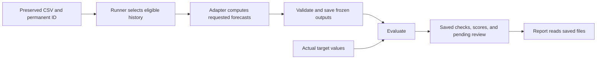
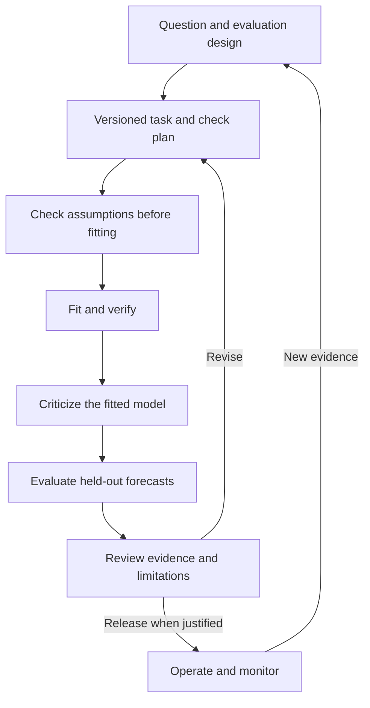

# Architecture: current behavior and future design

Read [the walkthrough](forecasting.md) for usage. This page explains responsibility
boundaries. Sections marked **implemented** describe code that exists; the later
workflow/checking sections are **design guidance**, not an implemented framework.

## Implemented execution path

The runner can parse/validate the complete input, but future actual values are
excluded from the request given to a model. Actuals are joined for scoring only
after forecast files are written and closed. This is a trusted Python boundary,
not a sandbox preventing an adapter from independently reading files.

| Responsibility | Implemented now | Remaining design |
|---|---|---|
| Application/task | A daily numerical CSV task with explicit timing assumptions and function arguments | A broader versioned application specification, richer calendars/features, real-data availability rules |
| Data preparation | Local copy/read, verified one-file snapshots, receipts, and tags | Remote sources, multi-file identity, processing lineage, reusable quality evidence |
| Model adapter | Training mean; fixed-variance Gaussian local level; declared output capabilities | Other families, parameter learning, incremental updates, specialized checks |
| Runner | Historical origins, eligible histories, output validation, fixed required checks, visible failures | Configurable stage/check dispatch and explicit experimental overrides |
| Evaluation | Point errors, quantile/equal-tail scores, separate highest-density set summaries | Full predictive density/sample scores when supported |
| Artifact storage | Local run directories, manifests, frozen forecasts, evaluations, checks, pending review | Run index, iteration lineage, integrity/recovery/retention automation |
| Reporting | Charts and matched-case comparisons from saved artifacts | Wider reports and application delivery |

A run's directory and manifest identify its model/configuration and saved cases.
There is no global run-ID registry. No orchestration service, release process,
or monitoring/deployment system is implemented.

## Implemented model boundary

[models.py](../src/model_pipelining/models.py) defines immutable requests/results.
A model receives eligible observations, issuance, target time, and requested
quantile probabilities/highest-density masses. It returns a predictive mean and
its declared uncertainty kinds. `TrainingMean` is point-only; `LocalLevel`
supplies quantiles and highest-density regions.

Both uncertainty kinds target the future observed value in original units.
State or parameter distributions would require separate diagnostic outputs.
Normal-specific filtering/quantile calculations stay inside the adapter. The
runner never branches on model-family names or invents missing uncertainty.

Capabilities make supported outputs required at the requested levels. Shared
checks enforce complete, finite, structurally valid outputs. Highest-density
sets preserve disconnected segments and nesting across masses, but their
probability mass and density optimality remain the adapter's mathematical
responsibility. Reports prefer supplied highest-density regions. The
[uncertainty reference](uncertainty.md) defines the records and compatible scores.

## Implemented artifacts and information boundaries

New run manifests use format version 2; the existing point CSV remains compatible.
Snapshots, acquisition events, and tags retain their separate format version 1.
Reports can read old version-1 saved point runs without generating new uncertainty.
See [the API reference](../src/model_pipelining/README.md) and
[run-file reference](../runs/README.md).

At every forecast origin, eligibility follows the task's information assumptions.
The synthetic task assumes each observation is immediately available and has no
revisions. Acquisition/registration timestamps do not establish real historical
availability. A revised series downloaded today needs a separate availability
policy before it supports a real-data historical claim.

Any later learned preprocessing or tuning must stay inside the appropriate
training/development boundaries. Current adapters have no such tuning. A target
held out from one forecast can become past training data for a later origin;
this does not make the entire development series an untouched final evaluation.

## Planned broader workflow

The intended long-term workflow separates defining a question, checking assumptions,
fitting, criticizing a model, evaluating held-out predictions, human review, and
possible operation/monitoring:

This diagram describes responsibilities to develop, not a current set of runner
stages. Forecasting, monitoring, and causal effect estimation need different
study designs; a predictive backtest alone does not establish a causal effect.

## Planned model-specific checks and iteration

The current runner owns a fixed list of validation/completion checks. A future
experiment-owned check plan should describe requirements, applicability,
criteria, and failure actions. Adapters could supply specialized evidence without
being allowed to omit required checks and thereby pass a run.

| Question | Bayesian example | Other-model example |
|---|---|---|
| Are assumptions plausible? | Prior predictive simulation | Feature availability and intended-use coverage |
| Did the calculation work? | Analytic recursion verification; sampler diagnostics only when a sampler is used | Fit completion and output validity |
| What does the fitted model miss? | Predictive replications and prior sensitivity | Residual patterns, ablation, regularization sensitivity |
| How do held-out forecasts behave? | Compatible point/distributional scores | Point scores and any explicitly supported uncertainty |

The local-level script saves one prior trajectory for human review; it does not
implement this whole plan. Existing numerical/simulation tests verify stated
calculation properties, rather than approving prior plausibility. The current
analytic filter has no MCMC (Markov chain Monte Carlo) sampler.

Simulation, parameter/state recovery, formal simulation-based calibration, and
held-out predictive calibration answer different questions. Expensive simulation
suites should run at a documented model/configuration scope, not automatically
inside every forecast origin. A future iteration record should preserve parent
runs, the motivating discrepancy, changed assumptions, and review decisions.
These records and configurable release rules are not implemented today.
