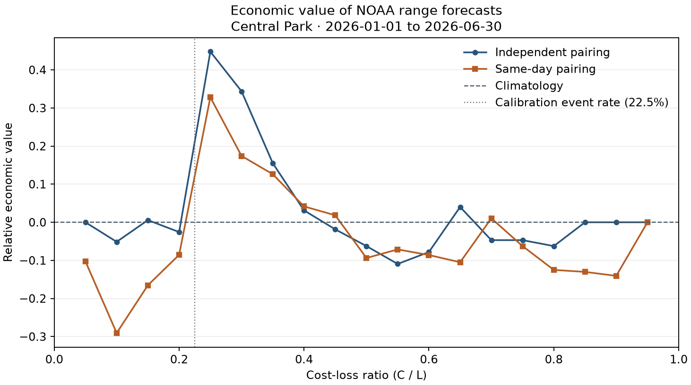

# Cost-loss decisions from saved forecasts

A probability forecast supports a decision when it changes whether you
take a protective action. This study asks how much that rule would have cost
on the saved [Central Park range forecasts](noaa-range-probability.md). The
event is a next-day temperature range of at least 10 °C.

## Decision and expense

Taking protection costs `C`. An unprotected event costs `L`. Protection
avoids the event loss, and waiting on a day without the event costs zero.
Divide all expenses by `L` and write `alpha = C / L`, with
`0 < alpha < 1`. Acting costs `alpha`. The forecast’s expected expense
of waiting is its event probability `p`. Act when `p > alpha`. At equality,
wait.

| Decision | Event occurs | Event does not occur |
|---|---|---|
| Act | Hit, expense `alpha` | False alarm, expense `alpha` |
| Wait | Miss, expense `1` | Correct negative, expense `0` |

Climatology uses a constant event probability `s` estimated from the 2025
calibration cohort. It acts on every case if `alpha < s` and waits on every
case otherwise. The observed evaluation outcomes determine the resulting
expense. Using their event rate to choose the climatology action would use
information unavailable when the forecasts were issued.

A perfect forecast acts on every event and waits otherwise. Its mean
expense is `alpha` times the observed evaluation event rate.

Relative economic value compares how much of the possible savings over
climatology the forecast achieved.

```text
V = (mean climatology expense − mean forecast expense)
    / (mean climatology expense − mean perfect expense)
```

`V = 1` matches the perfect forecast’s expense. `V = 0` matches
climatology. A negative value costs more than climatology. If climatology
and the perfect forecast have the same mean expense, the JSON records
`null` and a reason. The CSV leaves the value blank and retains the reason.

## Five cases by hand

Take `alpha = 0.20` and a separate calibration event rate of `0.40`.

| Case | Forecast probability | Event | Action | Expense |
|---|---:|---:|---|---:|
| 1 | 0.80 | 1 | Act | 0.20 |
| 2 | 0.45 | 1 | Act | 0.20 |
| 3 | 0.60 | 0 | Act | 0.20 |
| 4 | 0.20 | 0 | Wait | 0 |
| 5 | 0.10 | 0 | Wait | 0 |

The forecast has two hits, one false alarm, zero misses, and two correct
negatives. The mean forecast expense is `0.60 / 5 = 0.12`. Climatology
always acts because `0.20 < 0.40`, so its mean expense is `0.20`. The
perfect forecast acts on the two events and pays `0.40 / 5 = 0.08`.
The relative value is `(0.20 − 0.12) / (0.20 − 0.08) = 2/3`.

## Run the NOAA comparison

Supply a completed range evaluation directory and a new output directory.
The study reads `matched-range.csv` and `summary.json`, verifies the
evaluation dates and counts, and takes the climatology rate from
`summary.json` at `calibration.observed_events / calibration.cases`.
It scores the independent and same-day methods on the same cases at
ratios from 0.05 to 0.95 in steps of 0.05.

```bash
PYTHONPATH=src .venv/bin/python -m scripts.study_decision_value \
  --input-directory runs/noaa-range-2026-h1 \
  --output-directory runs/noaa-range-decision-value
```

The output directory contains `decision-value.csv` with counts, mean
expenses and value for each method and ratio,
`decision-value-summary.json` with those results and the input SHA-256
digests, alpha grid and base-rate source, and `decision-value.png`.
The command requires a new directory for each run.

The calculations are in
[decision_value.py](../src/model_pipelining/decision_value.py).
`evaluate_decisions(cases, *, alpha, base_rate)` takes an iterable of
`(probability, event)` pairs. `value_curve(cases, *, alphas, base_rate)`
evaluates the same pairs at each supplied ratio in order.

## Read the result

The plot shows the 181 frozen January–June 2026 forecasts. The 2025
calibration event rate was 82 of 365 days. The vertical line marks that rate
and the switch in climatology’s action. The horizontal line at zero marks
equal cost to climatology. Gaps indicate undefined value.



Results are descriptive for one station, one event, and one evaluation period.
Value depends on the cost-loss ratio. A forecast can save money for one user
and cost another user more than climatology. The fixed grid describes that
dependence, and no ratio or event threshold is selected or tuned on these
evaluation outcomes.

## Model-independent decision layer

[decisions.py](../src/model_pipelining/decisions.py) generalizes cost-loss
evaluation across saved runs without calling or refitting any model adapter.
Issuance and outcome scoring are separate caller actions that write to separate
directories so later outcome updates cannot alter frozen recommendations:

1. **Declare a `DecisionSpec`** (JSON format version 1) before scoring outcomes:
   event and action descriptions, target and horizon, policy parameters,
   calibration reference (pre-evaluation base rate or baseline action), and
   explicit fallback action for failed forecast origins.
   - `binary_cost_loss`: extracts exact threshold event probabilities
     ($P(Y \ge \tau)$, $P(Y > \tau)$, $P(Y \le \tau)$, or $P(Y < \tau)$) from
     frozen `predictive_distributions.json` (`gaussian_mixture`, `student_t`,
     or discrete `empirical_samples`, preserving strict vs. inclusive tie
     semantics on discrete atoms) or reads saved event probabilities (such as
     the NOAA range CSV), then acts when $p > \alpha$.
   - `continuous_asymmetric`: uses positive unit under-forecast (`under_cost`)
     and over-forecast (`over_cost`) costs, taking the exact
     `under_cost / (under_cost + over_cost)` predictive quantile (left-continuous
     inverse CDF for `empirical_samples`) as the recommended action. Its
     unit-sum-scaled expense equals unscaled pinball loss at that quantile level.
2. **Issue frozen recommendations** (`issue_decisions_from_run` or
   `issue_decisions_from_probabilities`): reads only forecast-time artifacts
   (never `evaluation.csv` or outcome columns) and writes `decision_spec.json`,
   `recommendations.csv`, and `decision_manifest.json` with SHA-256 digests.
   Failed forecast origins explicitly record `decision_source="fallback"` and
   apply the declared fallback policy.
3. **Score realized outcomes** (`score_decisions`): verifies the issued digests,
   joins outcomes from a backtest run directory, NOAA range directory, or plain
   CSV, and writes `decision_evaluation.csv`, `decision_summary.json`,
   `checks.json`, and a pending `review.json` in a new directory. Summaries
   include median, 90th/95th-percentile, and maximum case expense alongside the
   share of total expense concentrated in the worst 5% of origins. For
   `binary_cost_loss` without fallbacks, `decision_summary.json` also saves a
   **Brier reliability/resolution/uncertainty decomposition** (`brier_decomposition`,
   including Expected Calibration Error, probability bias, and Brier Skill Score
   against the predeclared calibration base rate) and an elementary **Murphy curve**
   (`binary_murphy_curve`); `decision_scores.png` includes a reliability diagram
   panel. For `continuous_asymmetric`, it saves the Ehm et al. (2016) elementary
   quantile Murphy curve (`quantile_murphy_curve`).
4. **Compare scored runs** (`compare_decision_scores`): checks identical
   `DecisionSpec`, targets, and observed outcomes, then writes paired expense
   differences (mean, median, win/loss/tie rates, action agreement, worst-5%
   concentration, and naive + Bartlett HAC standard errors) plus a **Murphy
   dominance comparison** (`first_dominates`, `second_dominates`, `tied`, or
   `crossing`) to `decision_comparison.md`, `decision_comparison.json`, and a
   3-panel `decision_comparison.png` (cumulative expense difference, mean vs.
   p95 bars, and Murphy diagram). For a plain-English walkthrough of all tools
   and metrics, see
   [the evaluation, baselines, and decision tools guide](evaluation-and-decisions.md).

### CLI workflow and automatic vs. caller actions

Run each stage explicitly with `scripts/run_decisions.py`; backtests never
invoke decision issuance or scoring automatically. `score` draws
`decision_scores.png` automatically unless `--no-plot` is passed, and `compare`
draws `decision_comparison.png` automatically.

```bash
PYTHONPATH=src .venv/bin/python -m scripts.run_decisions issue \
  --run-directory runs/noaa-central-park-20261119/verified-py312/forecast \
  --spec path/to/decision_spec.json \
  --output-directory runs/example-bayesian-issued

PYTHONPATH=src .venv/bin/python -m scripts.run_decisions score \
  --issued-directory runs/example-bayesian-issued \
  --outcomes runs/noaa-central-park-20261119/verified-py312/forecast \
  --output-directory runs/example-bayesian-scored

PYTHONPATH=src .venv/bin/python -m scripts.run_decisions compare \
  --first runs/example-noaa-independent-scored \
  --second runs/example-noaa-same-day-scored \
  --output-directory runs/example-noaa-comparison
```

### Verified examples on saved local runs

Both the saved Bayesian `LocalLevel` Central Park forecast
(`runs/noaa-central-park-20261119/verified-py312/forecast/`, 366 dates in 2024,
calibration references computed strictly from 2023 history: rate $\ge 25$ °C =
115/365 = 0.31507, 75th percentile = 25.6 °C) and the frozen NOAA range cohort
(`runs/noaa-range-2026-h1/`, 181 dates in January–June 2026, 2025 base rate
82/365 = 0.22466) were exercised end to end and replayed byte for byte under
`runs/decision-layer-verified-20261124/`:

| Saved example | Policy | Cases | Mean expense | Baseline | Perfect | Relative value | Top-5% expense share |
|---|---|---:|---:|---:|---:|---:|---:|
| Bayesian `LocalLevel` TMAX ($\ge 25$ °C, $\alpha = 0.25$) | Binary cost-loss | 366 | 0.12432 | 0.25000 | 0.07992 | 0.73896 | 23.6% (19 days) |
| Bayesian `LocalLevel` TMAX (3:1 under/over cost) | Continuous asymmetric | 366 | 4.61832 | 11.57295 | 0.00000 | 0.60094 | 17.0% (19 days) |
| NOAA range `independent` ($\ge 10$ °C, $\alpha = 0.25$) | Binary cost-loss | 181 | 0.23481 | 0.35359 | 0.08840 | 0.44792 | 23.5% (10 days) |
| NOAA range `same_day` ($\ge 10$ °C, $\alpha = 0.25$) | Binary cost-loss | 181 | 0.26657 | 0.35359 | 0.08840 | 0.32812 | 20.7% (10 days) |

Comparing `independent` minus `same_day` on the 181 NOAA dates at $\alpha = 0.25$
gives a mean expense difference of −0.03177 (Bartlett HAC SE 0.01646, lag 5)
with 77.3% action agreement; `same_day` had lower expense on 25 days versus 16
for `independent` (fewer false alarms, more misses), and 41.1% of the total
absolute expense difference concentrated in 10 days (top 5%). These figures are
descriptive development/study evidence, not an operational policy approval.
