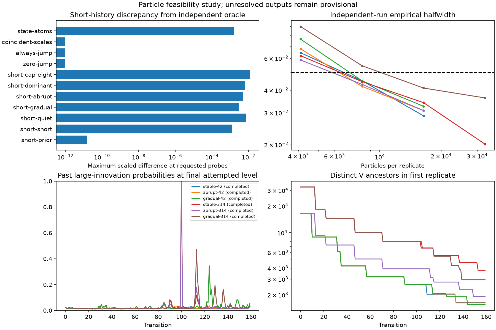

# Longer-history innovation particle prototype

This standalone numerical prototype approximates the fixed small/large innovation
[model](innovation-reference.md) for up to 512 daily observations. It samples the
shared observation variance V and past innovation labels, while integrating the
Gaussian states analytically. It returns moments and requested distribution
probes, independent-run Monte Carlo standard errors (MCSE), particle-count
refinement evidence and ancestry diagnostics. Unresolved calculations raise with
all attempted levels attached. Forecast/provider integration remains gated by
the numerical study described below.

## Explicit use

After [environment setup](../README.md#development-environment), run:

```bash
OPENBLAS_NUM_THREADS=1 PYTHONPATH=src .venv/bin/python scripts/run_innovation_particles.py \
  --config configs/innovation_particles.json \
  --output-directory runs/innovation-particles-new
```

Choose a new directory. This explicit research command expands and saves every
synthetic input, model setting, query and resource limit before fitting. It then
automatically runs the approximations and independent short-history references,
saves each attempted refinement and failed check, writes summaries and draws a
chart from saved results. An unresolved case or oracle disagreement produces exit
code 1 after preserving the remaining cases. Existing output directories are
rejected. Backtesting, ordinary imports and CI do not launch this large exercise.
All six long cases can take several minutes on one process. The thread setting
limits BLAS worker overhead; it does not change the model or precision budget.

```python
from model_pipelining.innovation_particles import (
    ParticleSettings, ParticlePrecisionError, run_innovation_particles,
)

try:
    result = run_innovation_particles(
        (0., .1, -.1, 3.8, 4.1, 3.9),
        settings=ParticleSettings(seed=0),
        predictive_points=(-2., 0., 2., 4., 6.),
        state_points=(0.,), variance_points=(.5, 1., 2.),
    )
except ParticlePrecisionError as error:
    evidence = error.evidence  # retain/inspect unresolved levels explicitly
```

The caller supplies ordered finite daily values; timestamps and irregular gaps
are outside this prototype. Model settings use `InnovationMixtureReference` and
default to the oracle's model. All query grids are strictly increasing finite
tuples/lists of up to 64 points; V queries must be positive. Stochastic fits require
`prior_shape > 2`, so the prior variance of V is finite for MCSE calculations.
The deterministic Gaussian/prior shortcuts retain the oracle's `shape > 1` rule.
Invalid inputs raise `ValueError` before simulation.

`ParticleSettings` defaults are 512 through 4,096 particles, 16 independent
replicates per level, seed 0, ESS resampling fraction .5, scaled tolerance .05,
nominal confidence .95 and minimum replicate-evidence ESS fraction .5. Counts
double, with at least two levels; supported counts are 32 through 65,536 and
replicates 8 through 128. The study explicitly selects 4,096 through 32,768
particles and 32 replicates. These are caller-controlled budgets, not fitted
model parameters. The smaller defaults can leave long histories unresolved.

## Conditional calculations and proposals

The initial Gaussian state is independent of V. Initial and innovation variances
are absolute variances, never scaled by V. There is one transition before the
first observation. Each particle draws one V from its inverse-gamma prior and
retains that value along its ancestry throughout the history.

For a particle with filtered mean m and variance C, the two observation variances
are `Q[j] = C + W[j] + V`. Compute both Gaussian observation log likelihoods and
their prior-weighted log sum `log a`. Propose the current label with probability
proportional to its prior times its likelihood. Update the particle weight by a,
then update m/C with the selected scalar Kalman transition. This proposal adapts
the label to the current observation; it does not optimally propose the shared V.

Systematic resampling occurs after an update when particle ESS falls below the
declared fraction. The final update remains weighted. Resampling copies V, the
entire label ancestry and the corresponding filtered state together; there is no
jitter, replacement V, component pruning or hidden rejuvenation. The product of
weighted likelihood increments supplies that run's evidence estimate. Likelihoods
and weights use log arithmetic; nonfinite calculations fail explicitly. Rounded
zero large-branch proposal probabilities and weights are counted; no density
floor is introduced.

At the end, each surviving V/path is filtered again and smoothed backward for
the joint initial/final state law. Final filtered means/variances must agree with
the online states. Gaussian conditional variances use positive recursion formulas
and genuine zero-variance states stay atoms. The prototype averages strict and
inclusive state CDFs separately.

Future observation CDFs/densities integrate both possible new innovations inside
every conditional V/path law. The next jump probability stays at the fixed prior
probability even after a likely historical jump. Gaussian components are not
replaced by a moment-matched normal. For histories of at most eight observations,
the result also reports every possible short path's estimated probability; long
histories report individual label marginals without enumerating `2**n` paths.
An estimated zero path mass is not a proven zero posterior mass.

The Rao-Blackwellization follows the approach described by
[Doucet et al.](https://arxiv.org/abs/1301.3853). The
[Doucet–Johansen tutorial](https://www.stats.ox.ac.uk/~doucet/doucet_johansen_tutorialPF2011.pdf)
describes sequential importance/resampling, observation-adapted proposals,
normalizer estimates, and the distinction between posterior spread and estimator
uncertainty. Here independent complete filters supply the estimator diagnostics;
particles within a resampled filter are not treated as independent replications.

## Combining runs and accepting a refinement

Let `Z[r]` be run r's evidence estimate and `f[r]` its normalized estimate of a
raw posterior expectation. Combine runs as
`sum(Z[r] * f[r]) / sum(Z[r])`, using a shared log-evidence offset for stability.
An equal average of normalized run estimates would discard their different
normalizing estimates. The reported log evidence is the log of the mean evidence,
rather than the mean log evidence. Finite-replicate ratio/log bias can remain.

Initial/final means are centered at the prior location before accumulating second
and joint moments. Only after aggregation are marginal variances, initial/final
covariance, and V/jump-count covariance calculated. Delete-one-run jackknife MCSE
recalculates those nonlinear summaries and log evidence for each omitted complete
run; it does not average within-run uncertainties or remove finite-sample bias.

The numerical comparison scale is the oracle's scale:
`s = max(1, sqrt(C0+n*Wlarge), sqrt(b/(a-1)), max(abs(y-m0)))`.
Means divide by s, variance/covariance quantities by `s**2`, densities multiply
by s, and probabilities, expected jump count and log evidence remain absolute.
This is a declared numerical budget, not a bound on the full distribution law.

For every requested scalar and each planned refinement look, a Bonferroni-adjusted
Student-t critical value multiplies the jackknife MCSE. A level passes only when:

- Its maximum scaled empirical halfwidth is at most the configured tolerance.
- Replicate-evidence ESS is at least the configured fraction of the run count,
  and every run retains at least two distinct V ancestors.
- A previous independent particle-count level exists, and the maximum scaled
  change plus both levels' maximum halfwidths is at most twice the tolerance.

The correction accounts for the declared finite probes/looks in one call under
the diagnostic assumptions. It does not establish exact simultaneous coverage,
cover other cases, or cure missed modes. Seed streams depend on root seed,
particle count and replicate index; adjacent refinements are independent.
Replay leaves NumPy's global RNG untouched. Every attempted level, replicate raw
summary, likelihood estimate, ESS/resampling history and ancestry count is kept.
Failures are never silently restarted or replaced.

No-history, zero/one jump-probability and coincident-variance cases automatically
use the existing checked scalar V quadrature. Coincident scales integrate labels
at their independent prior analytically. Initial/final moments use the same
conditional smoother. V CDFs integrate to each query boundary through the native
posterior CDF; they do not use the discrete quadrature-node CDF. These results
save native numerical evidence and `mcse: null`, keeping quadrature diagnostics
distinct from Monte Carlo uncertainty.

## Frozen exercise and interpretation

The [configuration](../configs/innovation_particles.json) retains all seven
original oracle cases, adds zero/one probability, coincident scales and a real
state-atom case, and generates three matched 160-observation scenarios for each
of seeds 42 and 314. The first seed reproduces the prior study's development
observations: `random.Random(42).gauss(0,1)`, baseline 10, shift +5 starting at
index 100, or slope .05 beginning there. The second seed checks another synthetic
realization. The same noise is shared across scenarios within each seed; the
particle root seed is separately fixed at 0. No held-out forecast performance or
model adequacy inference follows from this numerical feasibility exercise.

The short oracle comparison checks every returned moment, short path mass and
CDF/density probe against the independent dense/adaptive result. The criterion
requires error within the corresponding empirical envelope plus 5e-6 numerical
allowance; Gaussian limits use 5e-6 directly. Rare unseen paths can have zero
empirical MCSE even with positive oracle mass. Such failures are preserved and
block the study's overall completion gate.

The recorded run is `runs/innovation-particles-verified-20261119/`. Its overall
precision status is **unresolved**. All 17 numerical calls completed; nine of the
11 short oracle comparisons passed and two failed on three rare-path quantities.
The maximum scaled short-case discrepancy is 0.011936. Gaussian zero/one/equal-scale
limits agree within 7.64e-13; the prior agrees within 1.51e-11.

| Long case | Accepted particles per run | Maximum scaled empirical halfwidth |
|---|---:|---:|
| Stable, seed 42 | 16,384 | 0.02884 |
| Abrupt, seed 42 | 16,384 | 0.03083 |
| Gradual, seed 42 | 16,384 | 0.03256 |
| Stable, seed 314 | 32,768 | 0.02012 |
| Abrupt, seed 314 | 16,384 | 0.03085 |
| Gradual, seed 314 | 32,768 | 0.03621 |

All six long cases pass the declared empirical gates. Final replicate-evidence
ESS exceeds 31.96 of 32, and every final run retains at least 1,475 distinct V
ancestors. These observations do not establish long-history posterior accuracy.
The exercise took about 445 seconds with one BLAS thread while other local
verification also ran; this is descriptive timing, not a controlled benchmark.

The quiet case never sampled paths `011100` and `101001`: both estimates and
MCSEs are zero, but oracle masses are 5.027e-6 and 6.258e-6. The gradual case's
`000111` path is estimated at 1.312e-6 versus oracle mass 2.175e-5, outside its
8.687e-6 empirical envelope including numerical allowance. The thresholds were
not relaxed after these failures. Forecast integration remains gated.

The saved audit verifies eight source hashes, recomputes all 34 saved level
aggregations and precision gates, replays all 11 short cases exactly, and replays
replicates 0 and 31 at the final level of each long case exactly (12 selected
replicates). It does **not** replay the entire long study. All 431 repository tests,
documentation checks, and the temporary two-model 170-case walkthrough pass.
The validation receipt's `passed` status concerns replay/arithmetic integrity;
it preserves the separate `unresolved` study-precision status.

The [curated summary](artifacts/innovation-particles-summary.json) retains the
results, source identities, audit scope and three failed envelopes. Full local
runs also retain `validate.py`, `validation.json`, `fixture_identity.json` and
`execution.json`. Earlier interrupted directories remain preserved: one exposed
threaded BLAS overhead; the other preceded normalization of numeric settings to
Python floats for JSON serialization. The final run freezes the corrected source
with unchanged model/settings/seeds/acceptance criteria. No commit, publication
or new hosted CI is implied.



The chart's short-case discrepancy bars do not indicate that every uncertainty
envelope passed; the two failed cases are documented above.

## Current limits and next work

The [conservative probability follow-up](innovation-probability-bounds.md)
supplies nonzero uncertainty for unseen paths and encloses all 872 retained
short-oracle probabilities. Its fixed-budget bounds remain too wide on abrupt
and long histories. The original failures and this investigation's unresolved
status remain unchanged; a wide enclosing interval does not establish precision.
The [next pilot](next-session.md#next-work) tests a data-informed importance
proposal with a provable weight bound. Targeted integration remains an alternative.

There is no certified discarded-mass bound or uniform CDF/density bound. The
diagnostics may miss unvisited modes or underestimate rare-path uncertainty.
Resampling cannot invent missing V values or restore old label diversity. Longer
histories, nearly noiseless data, extreme priors and rare jumps can exhaust the
budget. Independent-run ESS and ancestry counts are warnings about the sampled
population, not proofs that posterior support has been explored.

The next design decision must use both frozen investigations: establish useful
rare-path precision and, where needed, address static-V/path impoverishment
before integrating with shared forecasting/evidence boundaries. Then perform
fresh-path predictive criticism, prior robustness and calibration as separate
model evaluations. This prototype adds no forecasting serializer, HPD/quantile
engine, generative evidence provider, MCMC backend or automatic model approval.
