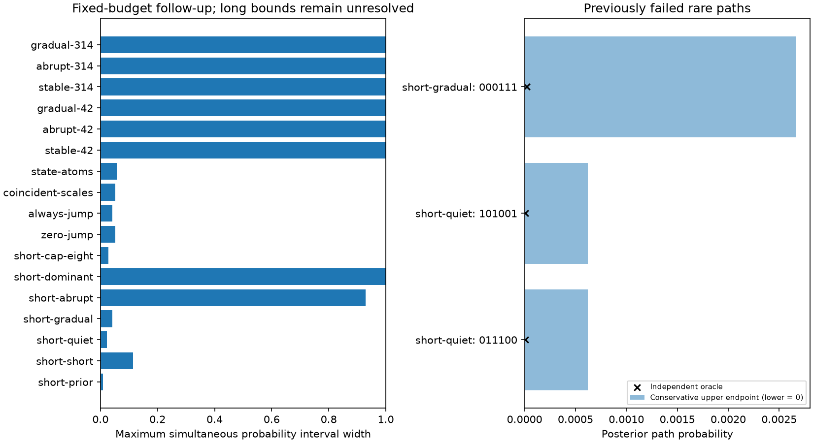

# Conservative innovation probability bounds

The [particle investigation](innovation-particles.md) found three overconfident
rare-path envelopes: two quiet-history paths were never sampled, and one gradual
path was underestimated. A zero empirical MCSE could not distinguish zero mass
from an unvisited event. This follow-up implements an independent probability
check with an explicit weight envelope and finite-sample uncertainty, including
when no sample visits an event.

**Outcome:** all 872 probabilities from the eleven retained short-history oracles
are inside the new bounds, including the three previous failures. The method is
too conservative to verify the longer-history approximation: three short cases
and all six 160-observation cases remain unresolved at the frozen budget. The
original particle failures remain unchanged, and forecast/provider integration
remains gated. An enclosing but very wide interval is not successful precision.

## Explicit caller actions

After [environment setup](../README.md#development-environment), the library can
be called independently of the particle approximation:

```python
from model_pipelining.innovation_probability_bounds import (
    ProbabilityBoundSettings, bound_innovation_probabilities,
)

result = bound_innovation_probabilities(
    (0., .1, -.1, .05, .1, -.05),
    settings=ProbabilityBoundSettings(samples=262144, seed=0),
    predictive_points=(-2., 0., 2., 4., 6.),
    state_points=(0.,), variance_points=(.5, 1., 2.),
)
print(result['status'], result['intervals']['sequence_probabilities'])
```

`bound_innovation_probabilities(values, *, model=None, settings=None,
predictive_points=(-2., 0., 2., 4., 6.), state_points=(0.,),
variance_points=(.5, 1., 2.))` accepts the same fixed
`InnovationMixtureReference` model and up to 512 ordered daily observations.
Query grids contain up to 64 strictly increasing finite points; variance queries
are positive. Probability calculations use the reference's `prior_shape > 1`
validation and require no additional moment assumption.

`ProbabilityBoundSettings` declares a fixed sample count (default 262,144,
supported 32..4,194,304), nonnegative seed (default 0), confidence (default .95,
supported .5 through values below 1) and tolerance (default .05, positive through
.1). The function automatically samples, smooths and computes all declared
intervals. It returns unresolved evidence when precision fails; it does not
retry, increase the sample budget, raise `ParticlePrecisionError`, or replace the
particle result. Invalid inputs or nonfinite arithmetic raise `ValueError`.
The caller must inspect `status` and `checks`.

To reproduce the saved follow-up, first retain or explicitly generate the
[parent particle study](innovation-particles.md#explicit-use), then run:

```bash
OPENBLAS_NUM_THREADS=1 PYTHONPATH=src .venv/bin/python scripts/check_innovation_probability_bounds.py \
  --source-directory runs/innovation-particles-verified-20261119 \
  --output-directory runs/innovation-probability-bounds-new \
  --samples 262144 --seed 0 --confidence .95
```

Choose a new output directory. The command checks parent source hashes and case/
oracle identities before creating output. It then automatically copies the parent
inputs and original failures, archives the implementation sources, runs every
case at one fixed budget, recalculates intervals from saved statistics and plots
saved results. The source directory stays unchanged. `study.json` distinguishes
successful computation from unresolved precision; exit code 1 retains all cases
when precision fails. Imports, backtests and CI do not launch this 17-case study.
CI runs the bounded unit and CLI fixtures separately.

## Bounded independent importance samples

Let V have inverse-gamma prior `IG(a,b)` and let n be the history length. Draw
independent V values from `q(V) = IG(a+n/2,b)` and independent innovation-label
paths from their original Bernoulli prior. Filter each V/path analytically.
Its Gaussian observation variances satisfy `Q[i] >= V`, so its likelihood obeys
`L(V,path) <= (2*pi*V)**(-n/2)`. Consequently:

```text
C = Gamma(a+n/2) / Gamma(a) * (2*pi*b)**(-n/2)
u = prior(V) * L(V,path) / (C * q(V))
  = product_i sqrt(V / Q[i]) * exp(-innovation[i]**2 / (2*Q[i]))
0 <= u <= 1
```

The path proposal is its prior, so its prior/proposal ratio cancels. The weight
calculation accumulates the displayed nonpositive log factors directly; it
avoids forming a huge C or subtracting unrelated log densities. For any bounded
conditional probability f, `E_q[u*f] / E_q[u]` equals its posterior probability,
and `E_q[u] = evidence/C`. These identities retain dependence between V, past
allocations and the Gaussian states.

Independent samples are processed in fixed chunks of 4,096. Every sample retains
its own V and complete label path until its conditional summaries are computed;
there is no resampling, ancestral copying, rejuvenation or path pruning. Memory
depends on one chunk's history and queries, not the total sample count or `2**n`
long paths. Short path probabilities use weighted counts; long histories report
label marginals without enumerating paths. `sequence_proposal_visits` counts
independent prior-proposal visits, not posterior effective samples.

## Uncertainty contract

For K bounded expectations, including the common normalizer, apply the
two-sided empirical Bernstein inequality to each mean and union the K events.
With sample count N, unbiased sample variance s² and confidence `1-alpha`, use:

```text
h = log(4*K/alpha)
radius = sqrt(2*s²*h/N) + 7*h/(3*(N-1))
expectation interval = [max(0, mean-radius), min(1, mean+radius)]
```

The inequality and its sample-variance convention are from Theorem 4 of
[Maurer and Pontil (2009)](https://www.cs.mcgill.ca/~colt2009/papers/012.pdf).
Applying it to a variable and its complement gives two tails; allocating
`alpha/(2*K)` to each tail gives the displayed logarithm. Functions within a draw
can be dependent. Independence is required across complete proposal draws.
The positive additive term remains when an event has zero observed mass and
zero sample variance.

Divide each numerator's lower endpoint by the normalizer's upper endpoint and
its upper endpoint by the normalizer's lower endpoint, clipping to [0,1]. If
the normalizer has no positive lower endpoint, the upper probability endpoint
is 1. In particular, all-zero weights yield [0,1] intervals and unresolved
precision, never zero uncertainty. No ad hoc probability or density floor is used.

The result covers requested label marginals, every short path probability,
initial/final strict and inclusive state CDFs, V CDFs, and full next-observation
CDF probes. The latter integrate both possible fresh innovations; their mixing
probability remains the model's fixed prior value. State atoms retain distinct
strict/inclusive values. Densities and unbounded state/V/joint moments retain
their separate existing numerical/MCSE checks; this method adds no bound for
them and no uniform distribution bound between requested points.

A call completes only if the normalizer has a positive lower bound and every
probability interval has width at most `2*tolerance`. This width criterion does
not assert that each ratio point estimate is at the interval midpoint. Confidence
applies to the one declared fixed-budget family under mathematical iid and
exact-arithmetic assumptions. Pseudorandom generation and floating arithmetic
are not formally certified; exponential underflows are counted. Repeated looks,
adaptive budget selection, extra events and other datasets need an additional
error allocation. The study fixes all cases/queries/counts in advance and divides
its .05 error budget equally among 17 cases, then among each case's bounded
expectations. This corrects the whole declared study without requiring case
independence.

## Frozen results and limits

The recorded follow-up is
`runs/innovation-probability-bounds-checked-20261119/`. It reuses the original
17 histories, models and query grids, with 262,144 independent draws per case,
seed 0 and 95% study confidence. The old particle summaries, empirical precision
claims and failed oracle envelopes remain archived as original evidence.

| Previously failed path | Independent oracle mass | New probability interval |
|---|---:|---:|
| Quiet `011100` | 5.027e-6 | [0, 6.197e-4] |
| Quiet `101001` | 6.258e-6 | [0, 6.203e-4] |
| Gradual `000111` | 2.175e-5 | [0, 2.669e-3] |

These intervals acknowledge uncertainty rather than reporting zero error. They
are deliberately much wider than the old empirical envelopes. All eleven short
oracle comparisons enclose their 872 probabilities (with the retained numerical
oracle allowance of 5e-6). Eight short cases meet the .1 width criterion. The
three-observation jump case, six-observation abrupt case and dominant case have
maximum widths .1140, .9300 and 1, respectively; they remain unresolved.
All six 160-observation cases have a zero normalizer lower bound and maximum
width 1. Enclosure alone therefore cannot clear this investigation's gate.

The conservative envelope explains this cost. At n=160, the proposal's mean V
is about .0244 under the reference prior, while the fixtures have observation
noise variance 1. Many proposed paths also fit the abrupt change poorly.
The envelope ignores that data-dependent inefficiency. A small estimated
normalizer relative to its finite-sample radius leaves ratios uninformative.
Increasing nominal particle ESS would not resolve this independent bound.

The [curated summary](artifacts/innovation-probability-bounds-summary.json)
records case outcomes, retained failures, source/input fingerprints and audit
scope. Full local results include source snapshots, copied parent inputs,
sufficient-statistic interval calculations and a separate validation receipt.
Replay/arithmetic integrity is separate from unresolved probability precision.

All 442 repository tests passed. The saved follow-up audit checks ten archived/
current source hashes and 31 archived/unchanged parent inputs, recalculates all
17 sets of intervals/checks, and replays all 17 independent fixed-budget calls
exactly. This replays the independent check, not the original long particle
study. All original Gaussian, atom, joint-moment and full predictive-density
tests remain in the passing suite. Documentation links/examples and both
temporary 170-case walkthrough runs are checked separately.



## Subsequent study

The subsequent [state-grid proposal](innovation-lattice.md) uses the
observations to propose plausible V and jump paths under an explicit bound.
It passes the original probability precision criteria on all 17 cases.
This study remains the baseline for those comparisons.
