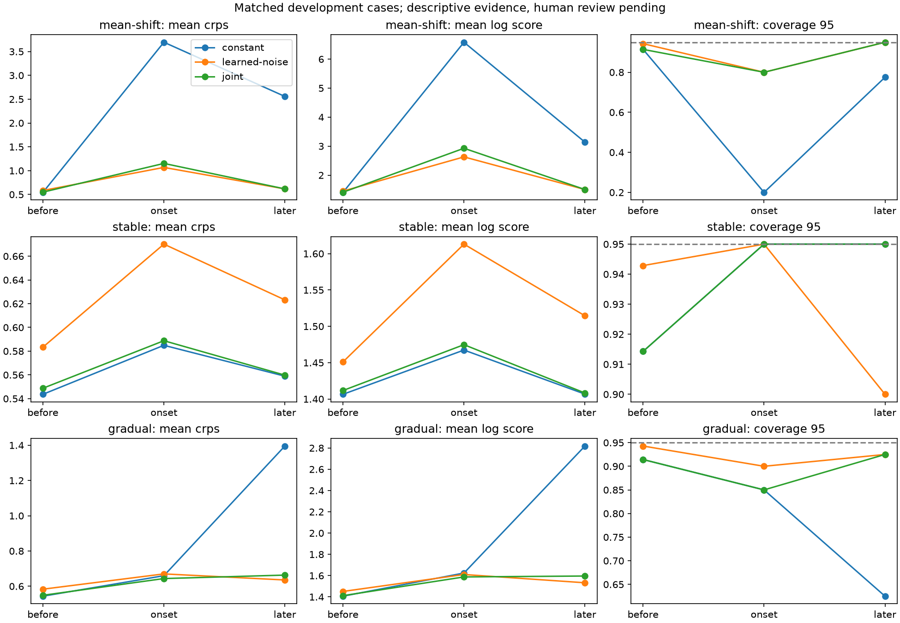

# Three-model development review — 2026-11-19

This study uses the existing forecast, evidence, calibration and saved-review
workflows to examine constant-mean Student-t, fixed-evolution learned-noise
local-level and categorical joint-variance models. It starts with the original
mean-shift fixture, then compares stable and gradual-change scenarios.
It is a known synthetic development exercise; scientific model approval and
application selection remain open.

All nine reference reviews are **ready for review**, with 27 required historical
workflows, 45 complete forecasts (5,850 cases), all declared prior alternatives
and 3,000 compatible replacement calibration trials. The joint model preserves
stable-period sharpness, but its small aggregate CRPS advantage changes under a
declared noise prior and its replicated shift-pattern discrepancy persists.
The [next bounded question](#bounded-next-modeling-question) investigates occasional
large state innovations with independent references before a new adapter/backend.

## Reproduce the exercise

From the repository root, after [environment setup](../README.md#development-environment):

```bash
PYTHONPATH=src .venv/bin/python scripts/review_model_study.py \
  --output-directory runs/model-review-study-new
PYTHONPATH=src .venv/bin/python scripts/check_study_priors.py \
  --study-directory runs/model-review-study-new \
  --output-directory runs/model-review-prior-checks-new
```

Choose a new output directory. This explicit command generates and registers
the three inputs under that directory, performs 1,000 fresh calibration trials
per reference model, then runs reference forecasts, all three required historical
evidence workflows, saved review assembly and each declared alternative-prior
forecast. It automatically draws reference/evidence/calibration/comparison charts
and saves complete-cohort case/window summaries and signed paired losses.
It does not fetch external data or run final evaluation. This research command
is not invoked by backtesting or CI. `--replications` and `--calibration-trials`
override the default counts for a separately identified exercise; small counts
do not inherit the interpretation of the recorded study.

The second explicit command restores the saved expanded alternative settings
and generates prior/posterior predictive checks for all 36 model/scenario/prior
combinations. It uses the parent's preserved snapshots, development boundary,
replication count and seed, and draws charts automatically. It can run once the
parent design's snapshots are prepared; it does not require unfinished forecast
outputs. Its output must also be new. No calibration is implied for alternatives.
The recorded supplement is `runs/model-review-prior-checks-20261119/`.

Joint-model paths can be expensive. After explicitly stopping the original
process, continue a prepared study with complete compatible calibration:

```bash
PYTHONPATH=src .venv/bin/python scripts/continue_model_review.py \
  --study-directory runs/model-review-study-new --workers 3
```

Do not run both orchestrators on the same study simultaneously. Continuation
uses separate model/scenario processes and directories. It reuses completed
forecasts only with matching source hashes, settings, input/specification,
levels and complete scoring cohorts. Native review rechecks completed evidence
and calibration. Required failures stop continuation for investigation; partial
artifacts are preserved with an `-interrupted-` suffix before recalculation.
Earlier reports remain, and `study.json.results[].latest_review` identifies each
newly assembled review. Continuation records its script hash and worker count.
The recorded study switched to three workers after its complete mean-shift
reference reviews; its model/evidence implementation and design stayed fixed.

The command freezes `study.json` with the expanded experiment, model settings,
alternative priors, seeds, windows and script/configuration hashes before fitting.
Study status and progress are updated there. The output directory also contains:

| Path | Evidence |
|---|---|
| `source/`, `store/` | Generated CSVs and preserved snapshots/registration records |
| `calibration/<model>/` | Model-level 20-observation prior/data trials, inference evidence and chart |
| `<scenario>/<model>/reference/` | 130 forecast cases, full laws, point/distribution/region scores and chart |
| `<scenario>/<model>/evidence/` | Predictive checks, prior influence and sequential checks with charts |
| `<scenario>/<model>/review/` | Compatible saved sources, required checks, source inventories and pending human review |
| `<scenario>/<model>/<prior>/` | Forecast sensitivity under each declared alternative; no additional calibration claim |
| `<scenario>/comparisons/` | All three reference-model pairs, complete matching cases and loss charts |
| `case_metrics.csv` | All forecast configurations; PIT from full frozen laws, standardized errors, 95% HPD membership/width and losses |
| `window_metrics.csv`, `summary.json` | Aggregates for every model/prior/window, including case counts and residual correlation |
| `paired_losses.csv` | Per-target candidate-minus-reference CRPS/log loss, within-model priors and between-model references |
| `scenario_comparison.png` | Reference-model losses and coverage in the predeclared windows |

The study CSV uses candidate-minus-reference signed losses with both identities
labelled. Native `comparison.json` files retain their documented first-minus-
second convention. Use those labels when comparing the two artifact formats.

Keep source folders with the reports. Generated runs remain ignored by Git.
The tracked interpretation below is separate from the automatically pending
human-review files; it does not grant model approval.

## Study design and information boundaries

All three inputs use the same 200 independent standard-normal errors generated
by `random.Random(42).gauss(0,1)`, beginning 2020-01-01 UTC. The stable level is
10; the abrupt level increases by 5 at zero-based day 100; the gradual level is
`10 + .05*max(0,t-99)`. The stable and abrupt source bytes reproduce the original
generator exactly. The ramp is a new scenario, distinct from the earlier
[dynamics investigation](joint-variance.md).

The snapshots are:

| Scenario | SHA-256 snapshot ID |
|---|---|
| Mean shift | `c7e9fbed4871a4e77166afc8e91b03de38881731bca8a8a370bdc91ebfa5cdf5` |
| Stable | `2510db2af47e4b61c8f356ddc41df922d8992611afaa94cb75def102bec6dc68` |
| Gradual | `02e47b63e122e6a83190653b4914c332ff53625a7f2f866456e1dbeb8fc1ce36` |

Models see timestamp/value histories only. Values are available immediately,
with no revisions; actuals use first release. Expanding histories begin with
30 observations, issuance follows that day's value, and the horizon is one day.
Development targets are days 30–159 (130 cases); days 160–199 are the excluded
final-role period. Historical evidence uses the first 160 values through
2020-06-08 23:59:59 UTC. The final period is not evaluated, and these familiar
fixtures do not certify untouched scientific evaluation.

Windows were recorded before execution:

| Window | Zero-based target days | Cases |
|---|---|---:|
| Before | 30–99 | 70 |
| Onset | 100–119 | 20 |
| Later | 120–159 | 40 |
| All | 30–159 | 130 |

Stable uses the same dates as a control, although no change occurs. The gradual
scenario is still changing in the later window. Residual lag-one correlation
uses only adjacent targets within each window; it never crosses a window edge.
Coverage is observed membership in 95% next-observation HPD regions; width sums
all segments. PIT uses the full Student-t or Gaussian-mixture CDF, not a normal
approximation. Neither repeated-case uncertainty nor a significance test is
implied by these descriptive summaries.

Reference settings and every alternative are copied from the existing
[constant](../configs/normal_mean_variance_priors.json),
[learned-noise](../configs/local_level_variance_priors.json) and
[joint](../configs/local_level_joint_priors.json) prior configurations. The scalar
model fixes evolution variance at 0.1. The joint model puts equal prior mass on
0, 0.01, 0.1 and 1. Numerical defaults are unchanged. The five constant-model,
four scalar-model and three joint-model alternatives are all retained; no prior
is selected by its score. Each reference has prior/posterior dataset checks,
matched prior-learning paths, sequential criticism and required compatible
calibration. Alternative forecasts assess score/PIT/region sensitivity; they
are not separate fully calibrated model approvals.

Only the nine reference model/input combinations assemble complete required
reviews. Alternative forecasts retain the same experiment plan for matched
scheduling, but their separate-workflow requirements remain pending. The
supplement supplies alternative predictive criticism, not complete alternative
evidence/calibration review bundles.

The separate prior-criticism supplement checks whole-dataset implications under
those same alternatives, with complete prior/posterior comparisons and charts.
It records the frozen parent design and its own script hash. No prior is removed
because of a large discrepancy or strong influence.

Historical evidence uses 1,000 replications per prior/posterior phase, seed 1910.
Fresh reference calibration uses 1,000 trials of 20 observations, seed 1911,
reused as model-level evidence across the three historical scenarios. This does
not validate inference at every forecast-history length. Whole-history posterior
checks replicate fresh trajectories conditional on parameter/initial-state
uncertainty, rather than copying a fitted latent path.

## Historical evidence and compatibility

The earlier scoring exercise contains matching reference forecasts, but its
experiment declares no historical requirements; it cannot be combined unchanged
with this explicit three-workflow plan. The earlier complete constant-model
assembly uses two 50-trial calibration exercises for assembly mechanics.
The larger original/follow-up calibration studies also predate changes to
shared/model source files. Their declared hashes differ from current sources;
the joint follow-up specifically differs on both local-level variance adapters.
They are preserved separately rather than relabelled or silently attached to
current forecasts. See [calibration](calibration.md) and
[mixed calibration](mixed-calibration.md) for their original findings, including
the initial band crossing and independent follow-up.

Fresh calibration here establishes a compatible current computational scope.
Finite-trial uniform-reference bands and interval mass retain their documented
meaning; completion does not approve a model. The review assembler still lists
older bundle/sequential environment omissions rather than inventing versions.

The first new exercise, `runs/model-review-study-20261119/`, found one failed
joint-model trial out of 1,000 (zero-based trial 538, seed 1911). The error was
`f(a) and f(b) must have different signs` in the observation-variance quantile.
Its largest W posterior probability was about 0.999999999979; conditional
quantile root error put the lower marginal bracket about 2.66e-12 above the
target CDF probability. Successful-only calibration bands did not apply to all
trials. The failure and its truth/data/inference record are retained. That study
was explicitly interrupted during the scalar-model historical evidence, before
changing the implementation; incomplete children retain their partial state.

The [joint quantile repair](joint-variance.md) widens a failing bracket side to
the checked conditional integration support. It does not change the model,
priors, quadrature acceptance or root tolerances. A regression recreates the
exact seeded trial and compares the result to a separately bracketed CDF root.
The replacement exercise uses `runs/model-review-study-20261119-fixed/` with
the same seeds/counts and all new source-compatible artifacts. Replaying the
same seed verifies the repair; it is not an independent calibration follow-up.

## Results and interpretation

### Calibration and the retained failure

The replacement study completed all 3,000 reference-model calibration trials
without computational failures. Maximum marginal CDF distances were 0.02477
(constant), 0.02656 (scalar) and 0.03009 (joint), below their respective saved
simultaneous 95% reference bands of 0.04681, 0.04893 and 0.05037. All 1,000 joint
truth/data files replayed byte for byte from the failed exercise. This same-seed
rerun checks the repair and restores complete-trial summaries; it is not an
independent follow-up or a demonstration of adequacy for these historical inputs.
For categorical W, closed equal-tail interval coverage must be read alongside
its actual posterior mass, rather than compared blindly with 0.95.

### Temporal discrepancies and prior robustness

The reference priors already expose useful distinctions before fitting.
Prior-predictive upper fractions for observed history means range from 0.098 to
0.167 across the nine combinations: their broad location assumptions admit
these levels. Variation and temporal shape are more revealing. On stable data,
99.4% of fixed-W prior replicas have at least the observed sample SD and 99.9%
have at least its CUSUM; the model implies substantially more movement. The joint
prior's corresponding fractions are 0.769 and 0.869, with its posterior learning
later concentrating on W=0. On the shift data, only 0.7% of constant-model prior
replicas reach the observed SD, and none reaches the observed CUSUM. Increasing
its noise scale can change spread without supplying temporal dependence.

All 36 alternative-prior predictive workflows completed: 1,000 prior and 1,000
posterior replications each, 72,000 datasets in total, without simulation or
statistic failures. The table records the range of posterior fractions with
replicated CUSUM at least as large as observed, across alternative priors only.
Every scenario uses the first 160 observations. The other discrepancy statistics
and prior-phase results remain in the saved summaries and charts. The tracked
[prior-criticism summary](artifacts/model-review-prior-criticism.csv) retains all
216 prior/phase/statistic rows for lag correlation, half-mean difference and
CUSUM, including counts, observed values and Wilson intervals.

| Scenario | Constant-mean alternatives | Scalar alternatives | Joint alternatives |
|---|---:|---:|---:|
| Mean shift | 0–0 | 0–0.001 | 0–0 |
| Stable | 0.450–0.450 | 0.999–1.000 | 0.469–0.476 |
| Gradual | 0–0 | 0.488–0.533 | 0.052–0.079 |

For the abrupt fixture, the replicated temporal pattern remains discrepant under
every tested prior. The scalar model's stable replicas tend toward larger CUSUM
and lag correlation than observed; the joint model's stable replicas are much
closer on these summaries. The fixed random walk therefore imposes unnecessary
movement on the stable control, while learning a global categorical W can reduce
that movement. The scalar model reproduces gradual-change CUSUM more readily
than abrupt-change CUSUM under these settings; the joint alternatives also retain
some gradual-pattern discrepancy.

These are descriptive simulation comparisons, not calibrated p-values or
approval thresholds. With zero exceedances in 1,000 independent replications,
the saved Wilson 95% upper bound is about 0.00383, not zero probability. A fraction
near one can expose excess model variation; it does not mean the model passed a
test. Common seeds help make the alternative exercises reproducible; the ranges
do not quantify uncertainty over all possible priors or generating processes.

### Forecast comparisons

Each row summarizes 130 matching development targets. CRPS and log loss are
lower-is-better losses; coverage/width refer to 95% next-observation HPD sets.
The tracked [complete window metrics](artifacts/model-review-window-metrics.csv)
retain all 180 model/prior/window rows, including PIT tails, residual correlation,
coverage, width and case counts. All 45 forecasts supplied complete matching
130-case development cohorts (5,850 cases); incomplete forecasts cannot enter
this summary.

| Scenario | Model | Mean CRPS | Mean log loss | Coverage | Mean width |
|---|---|---:|---:|---:|---:|
| Mean shift | Constant | 1.64837 | 2.73546 | 0.762 | 5.726 |
| Mean shift | Learned noise | 0.66828 | 1.64919 | 0.923 | 4.153 |
| Mean shift | Joint W/V | 0.66253 | 1.67372 | 0.908 | 3.968 |
| Stable | Constant | 0.55471 | 1.41595 | 0.931 | 3.523 |
| Stable | Learned noise | 0.60899 | 1.49552 | 0.931 | 3.968 |
| Stable | Joint W/V | 0.55832 | 1.42036 | 0.931 | 3.568 |
| Gradual | Constant | 0.82365 | 1.87440 | 0.815 | 3.739 |
| Gradual | Learned noise | 0.61282 | 1.50071 | 0.931 | 3.968 |
| Gradual | Joint W/V | 0.59861 | 1.49551 | 0.908 | 3.640 |



Each plotted point represents 70 before, 20 onset or 40 later cases. Scenarios
use different vertical scales. The dashed coverage line marks the nominal
probability; it is not an acceptance threshold. This curated figure is tracked;
ordinary research commands save charts under the selected run directory. Updating
curated documentation assets remains an explicit caller action.

The mean-shift reference forecasts reproduce the earlier aggregate losses.
Splitting them at the predeclared change makes an important tradeoff visible:

| Model | Before CRPS (70 cases) | Onset CRPS (20 cases) | Onset log loss | Onset 95% coverage | Later 95% coverage (40 cases) |
|---|---:|---:|---:|---:|---:|
| Constant | 0.54367 | 3.69568 | 6.58176 | 0.200 | 0.775 |
| Learned noise, fixed W | 0.58340 | 1.06799 | 2.63008 | 0.800 | 0.950 |
| Joint categorical W/V | 0.54876 | 1.15180 | 2.92731 | 0.800 | 0.950 |

The joint model's slightly lower aggregate CRPS comes from better stable-period
behavior, despite worse onset CRPS/log loss than the fixed-W model. Both dynamic
models have almost identical later losses. A single global W can adapt between
histories but cannot express quiet stretches and rare large state innovations
as distinct parts of one transition law.

The constant model's onset mean PIT is 0.986, with 16 of 20 observations above
the 97.5th predictive percentile. Its later mean PIT remains 0.923 while the
dynamic models return to about 0.515. Its later 95% regions average 9.436 units
wide, versus 4.518 for both dynamics models, yet still cover fewer observations.
This is persistent location error absorbed partly into learned observation
variance. Simply widening predictions does not restore the constant-level
assumption. Onset standardized residual lag-one correlation is about 0.336 for
fixed W and 0.440 for joint W/V; the 20-case windows are descriptive, not
independent-sample tests.

The onset window includes the first unannounced jump. A subsequent exploratory
check separates its surprise cost from adaptation: on days 101–119, excluding
that first target, fixed-W versus joint CRPS is 0.83287 versus 0.89837 and log
loss is 1.84363 versus 1.93815. Excluding the first two targets (days 102–119),
CRPS is already very similar, 0.75287 versus 0.75691. The joint model's extra
adaptation cost is concentrated around one additional update, rather than
persisting through the whole onset window. These diagnostic subsets were
defined after inspecting the predeclared window contrast; they are not new
selection windows or untouched evaluation. Retain the complete 20-case results.
The tracked [onset case metrics](artifacts/model-review-onset-cases.csv) retain
both dynamic models' 20 targets, histories/vintages, errors, PIT, regions and
losses for inspecting this distinction.

On the stable control, mean CRPS/log loss is 0.55471/1.41595 for the constant
model, 0.60899/1.49552 for fixed W, and 0.55832/1.42036 for joint W/V. All three
cover 121 of 130 observations with their 95% HPD regions, while mean widths are
3.523, 3.968 and 3.568 units respectively. The joint model retains almost all
the constant model's stable-period sharpness. In the fit immediately before the
last development target, it assigns about 98.2% W mass to zero on stable data
and about 99.99994% to W=0.1 on the abrupt fixture. These are distinct histories
with shared noise, not a guarantee of consistent model selection.

The gradual control shows a related aggregate/window distinction. Joint W/V has
slightly lower overall losses than fixed W, but later CRPS is 0.66332 versus
0.63567, and later mean PIT is 0.651 versus 0.559. Its later mean innovation is
0.544 units versus 0.204: the learned global dynamics still lag the sustained
ramp. The constant model's later coverage falls to 0.625. A proposed occasional-
jump transition addresses the abrupt-change question first; it does not claim
to solve persistent directional drift. Keep gradual change as a separate control
and retain that discrepancy when evaluating any revision.

The mean-shift conclusions also separate robust discrepancies from fragile
rankings. Across all declared priors, constant-model mean CRPS spans
1.63720–1.72215, fixed-W CRPS 0.66466–0.66993 and joint CRPS
0.66253–0.67286. Both dynamics models consistently improve on the constant mean
in this exercise, but the small ranking between them changes with assumptions.
With the shared larger-V-prior alternative (`prior_scale=18`), fixed W has
CRPS 0.66993 and joint W/V 0.67286, reversing the reference CRPS ordering.
Their log losses are 1.63303 and 1.65419 respectively. Joint onset CRPS remains
larger across its declared range (1.15180–1.23036) than fixed W's
(1.06764–1.10152). These are the complete declared alternatives, not a tuning
grid or an estimate of uncertainty across arbitrary priors. The persistent
replicated shift-pattern discrepancy is more stable than the aggregate ranking.

The controls retain their qualitative comparisons across the declared priors.
Stable mean CRPS ranges are 0.55283–0.55497 (constant), 0.60116–0.60916
(fixed W) and 0.55534–0.55832 (joint). On gradual change, joint has lower
aggregate CRPS across its range, 0.59861–0.60369, than fixed W,
0.60546–0.61299. In the later ramp window the ordering reverses throughout
the tested ranges: fixed W is 0.62899–0.63576 and joint is
0.66332–0.68096. Prior changes affect magnitudes and coverage, but the
aggregate/window distinction remains. These ranges do not constitute
independent uncertainty intervals or evidence for selecting the smallest value.

## Bounded next modeling question

The subsequent [short-history reference prototype](innovation-reference.md)
implements the independent enumeration and Gaussian-limit investigation below.
It is deliberately capped at eight observations. A longer-history approximation,
full forecasting integration and the remaining criticism/calibration work stay
separate; this follow-up does not change the study's forecast results.

The current models already serve the infrastructure benchmark: exact conjugate,
checked numerical state/noise integration and discrete model uncertainty all use
the same selection, freezing, scoring and review boundaries. Their remaining
scientific discrepancies can stay visible while they remain reference adapters.

The proposed next question is: **can a transition with occasional large
innovations retain quiet-period behavior while adapting to an abrupt change?**
The current categorical W model learns one scale for an entire trajectory. Its
stable-period gains and onset losses, together with the persistent replicated
shift-pattern discrepancy, motivate investigating the innovation law itself.
Increasing the density of a continuous global-W prior would answer a different
question. A new inference backend needs a demonstrated computational need.

The first scope should be a reference prototype with a caller-specified mixture
of small and large Gaussian state innovations. Keep its mixture probability and
two innovation variances fixed initially, retaining learned observation variance.
This isolates the transition question before adding more unknown hyperparameters.
It is a candidate investigation, not an implemented adapter, chosen application,
claim of superiority or model approval.

Before accepting a forecasting implementation, require:

1. An independent short-history reference: enumerate innovation-component
   sequences, use batch Gaussian likelihood/state conditioning, integrate V
   independently, and sum all sequence probabilities. Compare evidence, state/V
   posterior summaries and the full next-observation law.
2. Limiting cases: zero/one large-innovation probability and coincident component
   variances recover the corresponding existing Gaussian local-level model.
3. Explicit inference precision and feasibility. Any longer-history approximation
   must account for retained/discarded probability and compare with the finite
   reference; it must not silently prune modes, replace a mixture with one normal
   law or average conditional interval endpoints. Select a sampler only if the
   selected approximation actually needs it.
4. Prior/posterior fresh-path replication and matched prior comparisons for the
   new transition. Preserve dependence between innovation allocations, states
   and V; replicating a fitted path would check a different object.
5. Data-free calibration/recovery with failed trials retained and atom-aware
   summaries where applicable. Validate inference separately from historical
   model adequacy, including histories with nearly dominant components.
6. The same stable/gradual/abrupt comparisons, predeclared onset/later windows and
   independent noise seeds. Measure stable-period sharpness, onset adaptation,
   PIT/dependence, full-law losses and whole-dataset discrepancies. A surprise
   jump's first target need not be predicted in advance. Preserve the current
   models as references; do not approve a model from one aggregate loss.

The current infrastructure already supports the historical selection, explicit
evidence requirements, saved distributions, losses, failures and reviews needed
for that iteration. Any additional evidence schema should follow the reference
prototype's concrete outputs. A contrasting model family remains a useful later
test of adapter independence, and a real-data exercise remains deferred.

## Limits and verification

This study uses one shared noise realization, one shift magnitude and one ramp
slope. Alternative-prior ranges cover the declared choices only. Calibration
uses 20-observation prior/data trials, rather than every historical sample size,
and the alternative priors have no separate calibration studies. Bundle and
sequential artifacts still omit some environment versions. These omissions stay
explicit in saved review; none is inferred from successful execution.

The complete suite passed **401 tests**, including nine new study/cohort tests and
the seeded quantile regression. The tests verify original input bytes, shared
noise, full-CDF saved-only calculations, final exclusion, histories/vintages,
rejected incomplete/duplicate region and score cohorts, and window boundaries.
Continuation checks also reject incompatible completed sources/designs and retain
failed or interrupted artifacts explicitly.
The quantile regression also uses a separately bracketed CDF root. Documentation
links/examples and the temporary 170-case forecasting walkthrough are checked
separately from the large explicit study.

The saved study audit passed: all 45 forecast cohorts are complete, all nine
latest reference reviews are ready, all 27 required workflows passed, all 3,000
current calibration trials computed, and all 102 report links exist. Pre-change
case metrics match exactly across the shared-noise scenarios for every prior.
Reference PIT agrees with the separately executed sequential workflow within
1e-10. Forecast/native source fingerprints and archived continuation source
hashes match their recorded files. The primary audit is
`runs/model-review-study-20261119-fixed/validation.json`; the supplement has its
own validation record for 36 workflows and 72,000 replications. Reports preserve
environment omissions and pending human interpretation.
