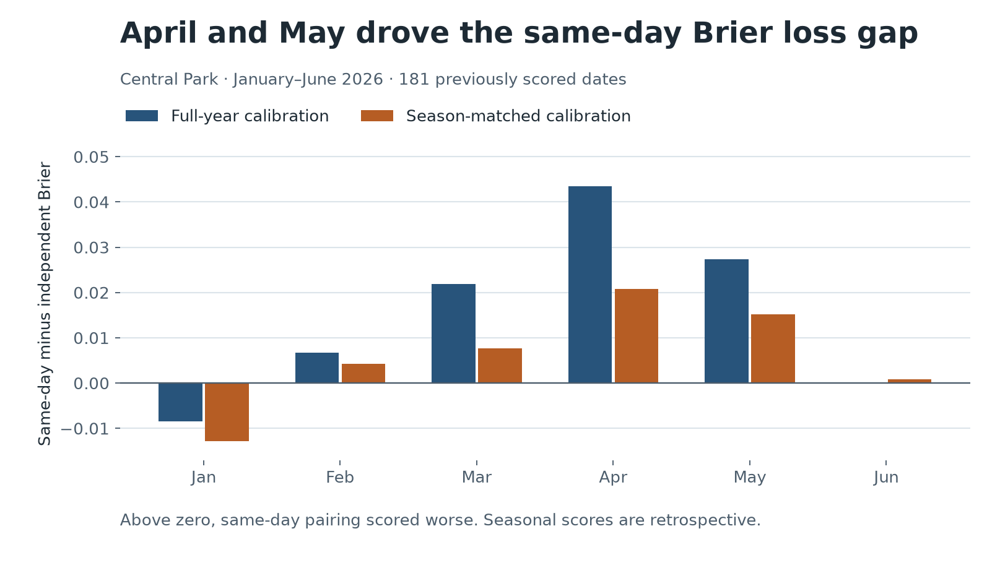
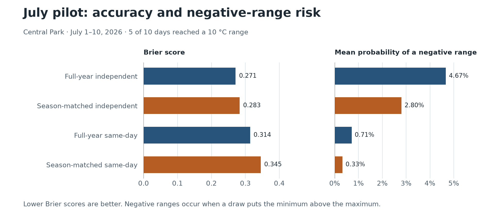

# Probability of tomorrow’s temperature range at Central Park

Compare two probability forecasts for the event that tomorrow’s daily maximum
minus minimum is at least a specified Celsius threshold. The
[paired 2025 study](noaa-temperature-pair.md) supplies the calibration cohort.
Its observed range reached 10 °C on 82 of 365 dates (22.5%). The later study
uses the same point-model settings and refits separate annual-plus-lag
regressions with the eligible expanding histories.

For each 2025 date, take actual minus forecast for the minimum and maximum.
Add those errors to the two point forecasts and take maximum minus minimum.
The same-day method uses the 365 date-matched error pairs. The independent
method uses all 133,225 combinations of the same marginal errors. Each draw
within a method has equal weight. Counting over these finite sets gives the
probability of a range at least as large as the threshold and the probability
of a strictly negative range. Crossed draws stay in their denominators.

The score is the mean squared difference between forecast probability and
the event indicator (Brier score, lower is better). The summary reports the
mean same-day score minus the independent score on the same dates, so a
negative difference favors same-day pairing for that cohort. It also reports
event counts, mean probabilities, and observed event rates in fixed
probability bins of width 0.1. These are descriptive comparisons. Date-label
availability is simulated, and the results pertain to this station, event,
and evaluation window.

## January–June 2026 results

The study froze January 1 through June 30, 2026, a 10 °C threshold and paired
Brier scoring before requesting the later archive. The
[NOAA Central Park archive](https://www.ncei.noaa.gov/products/land-based-station/global-historical-climatology-network-daily)
supplied all 181 dates with blank quality flags for both temperatures. The
range reached 10 °C on 64 dates (35.4%), compared with 82 of 365 dates (22.5%)
in the 2025 calibration cohort.

| Residual pairing | Mean Brier score | Mean event probability | Mean probability of a negative range |
|---|---:|---:|---:|
| Independent | 0.22415 | 37.4% | 5.01% |
| Same day | 0.23935 | 30.8% | 0.91% |

Same-day pairing raised the mean Brier loss by 0.01520 on the matched dates.
It also reduced the probability of draws with the minimum above the maximum.
All observed and point-forecast ranges were nonnegative. The results compare
one event on one six-month cohort using simulated availability.

The Python 3.12 audit recomputed all 181 probability and Brier rows by direct
enumeration and replayed ten output files byte for byte. The plan and evaluation
are saved locally in `runs/noaa-range-2026-h1-plan/` and
`runs/noaa-range-2026-h1/`. The tracked
[summary and audit](artifacts/noaa-range-probability-summary.json) record the
source and plan digests, calibration bins and replay receipts.

## Freeze and evaluate

Confirm the inclusive evaluation dates, Celsius threshold, Brier scoring and
seasonal settings before acquiring the later NOAA values. The following
commands reproduce the 10 °C design for January–June 2026. Supply
the completed 2025 studies and new output directories. Run with the research
environment or the [Python 3.12 profile](python312-public-forecast.md).

```bash
PYTHONPATH=src .venv/bin/python -m scripts.study_noaa_range freeze \
  --pair-study runs/noaa-extrema-new \
  --maximum-study runs/noaa-2025-new \
  --start 2026-01-01 --end 2026-06-30 --threshold 10 --score brier \
  --output-directory runs/noaa-range-plan
```

`freeze` verifies the original completed forecasts, origins and normalized
snapshots. It copies the matched 2025 table and exact histories, then saves
`plan.json` and its digest. The plan pins those files, the packaged regression,
NOAA parser, saved-forecast checks and study sources. The caller downloads the
metric archive with attributes from the URL in the frozen plan. It starts on
January 1, 2026 so days before a later requested start are available for
training.

```bash
source_url="$(.venv/bin/python -c 'import json; from pathlib import Path; print(json.loads(Path("runs/noaa-range-plan/plan.json").read_text())["source_url"])')"
curl --fail --show-error --location "$source_url" --output runs/noaa-range-later.csv
PYTHONPATH=src .venv/bin/python -m scripts.study_noaa_range evaluate \
  --study runs/noaa-range-plan --source runs/noaa-range-later.csv \
  --output-directory runs/noaa-range-evaluation
```

`evaluate` verifies the plan, sources and frozen inputs before opening the
later CSV. It validates the station, full calendar and both quality flag
columns, preserves the archive and expanded scalar snapshots, and checks
matched forecast origins and cutoffs before scoring. The study reads the
runner’s saved predictions and evaluates both probability methods on the
same cases. Use the same frozen plan, archive bytes, environment and a new
output directory to replay. NOAA can revise the archive, so use the preserved
source file for exact reproduction.

| Output | Contents |
|---|---|
| `inputs.json` | Frozen plan digest and raw archive snapshot ID |
| `tmin/`, `tmax/` | Scalar forecasts, schedules, scores and snapshot references |
| `matched-range.csv` | Date, issuance, cutoff, observed and predicted ranges, event indicator, both probabilities, crossing probabilities and paired Brier losses |
| `summary.json` | Evaluation event count, mean scores and difference, negative-range diagnostics and calibration bins |

## Seasonal calibration follow-up

### Diagnosis on the saved January–June cohort

The 10 °C event occurred on 50 of 181 days in January–June 2025 (27.6%) and
64 of 181 in the same months of 2026 (35.4%). The 2025 full-year rate was
22.5%. Comparing the same months reduces the rate gap from 12.9 to 7.7
percentage points. The remaining gap is descriptive.

| Month | 2025 events | 2026 events | Full-year same-day minus independent Brier | Season-matched same-day minus independent Brier |
|---|---:|---:|---:|---:|
| January | 1 | 3 | −0.00847 | −0.01281 |
| February | 2 | 5 | +0.00666 | +0.00422 |
| March | 13 | 13 | +0.02184 | +0.00762 |
| April | 14 | 15 | +0.04354 | +0.02082 |
| May | 11 | 15 | +0.02737 | +0.01521 |
| June | 9 | 13 | −0.00018 | +0.00084 |

April and May account for about 78% of the total excess same-day loss under
full-year calibration. The standard deviation of the 2025 range errors was
4.40 °C in March–May, 2.62 °C in December–February and 2.35 °C in June–August.
Matching seasons reduced the retrospective gap from 0.01520 to 0.00596 and
lowered both methods’ aggregate Brier scores. The saved January–June dates
informed the follow-up design.



### Frozen July pilot

The follow-up keeps the annual-plus-lag forecasts, 10 °C threshold and paired
Brier score. For a target in DJF, MAM, JJA or SON, the seasonal methods use
only 2025 residuals from the same three-month season. The four pool sizes are
90, 92, 92 and 91 dates. Within a pool, independent pairing crosses all
minimum and maximum errors, and same-day pairing uses the original date
pairs. The two full-year methods serve as controls.

The July 1–10, 2026 pilot scored ten fresh dates. Five reached 10 °C.

| Calibration and pairing | Mean Brier score | Mean probability of a negative range |
|---|---:|---:|
| Full-year independent | 0.27132 | 4.67% |
| Full-year same-day | 0.31401 | 0.71% |
| Seasonal independent | 0.28328 | 2.80% |
| Seasonal same-day | 0.34538 | 0.33% |



Season matching increased Brier loss by 0.01196 for independent pairing and
0.03137 for same-day pairing, and reduced negative-range probability for
both. The pilot covers ten dates in one season. A 174-date window covering
July 11 through December 31, 2026 was frozen before the pilot download and
awaits a complete archive. The
[curated diagnostic, result and audit](artifacts/noaa-range-seasonal-summary.json)
record the verification of all 40 case-method scores by direct enumeration
and five byte-identical replay files.

### Reproduce the seasonal comparison

`diagnose` reads the frozen January–June inputs and saved results. It checks
the original annual scores and writes by-month losses, event counts,
calibration and residual summaries. `freeze` copies the verified
January–June archive for use as training history and pins the baseline plan
and seasonal rule. The caller acquires only the newly needed archive dates
using the URL in the resulting plan.

```bash
PYTHONPATH=src .venv/bin/python -m scripts.study_noaa_range_seasons diagnose \
  --study runs/noaa-range-2026-h1-plan --run runs/noaa-range-2026-h1 \
  --output runs/noaa-range-season-diagnostic-replay.json
PYTHONPATH=src .venv/bin/python -m scripts.study_noaa_range_seasons freeze \
  --study runs/noaa-range-2026-h1-plan --run runs/noaa-range-2026-h1 \
  --start 2026-07-01 --end 2026-07-10 --output runs/noaa-seasonal-pilot-plan
source_url="$(.venv/bin/python -c 'import json; from pathlib import Path; print(json.loads(Path("runs/noaa-seasonal-pilot-plan/plan.json").read_text())["source_url"])')"
curl --fail --show-error --location "$source_url" --output runs/noaa-seasonal-pilot-source.csv
PYTHONPATH=src .venv/bin/python -m scripts.study_noaa_range_seasons evaluate \
  --study runs/noaa-seasonal-pilot-plan --source runs/noaa-seasonal-pilot-source.csv \
  --output runs/noaa-seasonal-pilot-replay
```

`evaluate` verifies both plans before opening the new CSV. It preserves the
download, joins it to the pinned archive, runs the scalar baseline once per
extreme, and scores the same saved point forecasts with all four methods in
`matched-range.csv` and `summary.json`. For exact replay, use the saved
pilot plan under `runs/noaa-range-seasonal-2026-july-pilot-plan/` and the
preserved `noaa-july-pilot.csv`. The longer frozen plan is under
`runs/noaa-range-seasonal-2026-h2-plan/`.
